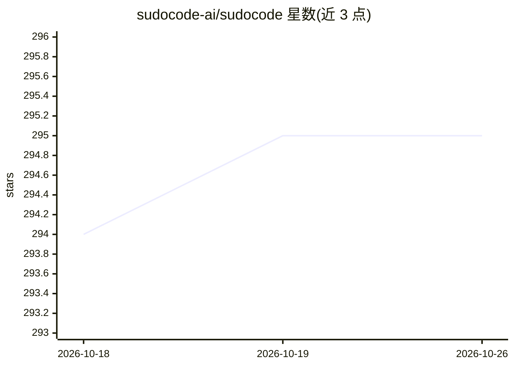

# sudocode-ai/sudocode

⭐ 295 · TypeScript · Apache-2.0 · 推送 2026-03-18 · [GitHub](https://github.com/sudocode-ai/sudocode) · [官网](https://sudocode.ai) · 组织维护

**开发者工具：在代码仓库内编排与记忆多 coding agent 协作**

sudocode 是一个驻留在 git 仓库中的轻量级 agent 编排系统，面向使用 Claude Code、Codex、Cursor 等 coding agent 的开发者。它以 specs（用户意图）与 issues（agent 任务）两种原语为核心，将上下文以 Markdown+YAML 与 JSONL/SQLite 双格式存储在仓库内并通过 git 同步，构成版本控制的 agent 记忆系统；提供 CLI、本地服务器/UI 与 MCP 服务器，支持 issue 依赖图的拓扑排序自动化执行、看板跟踪与执行监控，并可通过插件同步 Beads、Spec-Kit、OpenSpec 等外部系统。

## 筛选速览

| 维度 | 判定 | 备注 |
|---|---|---|
| AI 角色 | `ai-ecosystem` | LLM/agent 周边工具 |
| 许可风险 | `permissive` | Apache-2.0 |
| 部署形态 | `library` | 以包/库形式分发 |
| 模型依赖 | — | README 未给出锁定关系 |
| 硬件要求 | — | 无带数字的原话,不猜 |
| 安装摩擦 | `low` | 无编译、无系统依赖或容器化 |
| 成熟度 | — | 结构信号不足 |

## 能力要点

- git 原生 agent 记忆系统：specs/issues 以 Markdown+JSONL 存于 .sudocode/ 并经 git 分布式同步
- 并行运行多个 Claude Code/Codex/Cursor agent 并提供看板与执行监控 UI
- issue 依赖图按拓扑排序自动化执行，每 issue 独立 commit 可回滚
- 插件式外部集成：Beads/Spec-Kit/OpenSpec 双向同步，Jira/Linear 标注 Coming soon

## 适用场景

- 让多个 coding agent 在长周期任务中共享上下文并协作开发
- 用 specs 驱动开发，把需求与实现计划组织成可执行的 issue 图
- 通过本地 UI 跟踪 agent 执行进度并给予反馈

## 场景标签

`Agent 记忆` `多智能体` `Agent 框架` · 领域:Agent 开发

## 证据(README 行号)

> L19: sudocode is a lightweight agent orchestration system that lives in your repo. Adding sudocode into your repo adds i
> L36: The sudocode package includes a CLI, local server/UI, and an MCP server.

## 星数曲线

2026-10-18 294 → 2026-10-26 295（+1）

---
*卡片 v1 · prompt 1.4 · 生成 2026-10-21 · 置信度 high · 依据 README sha `c33845e20b59` · [字段定义](../../DATASET.md)*
