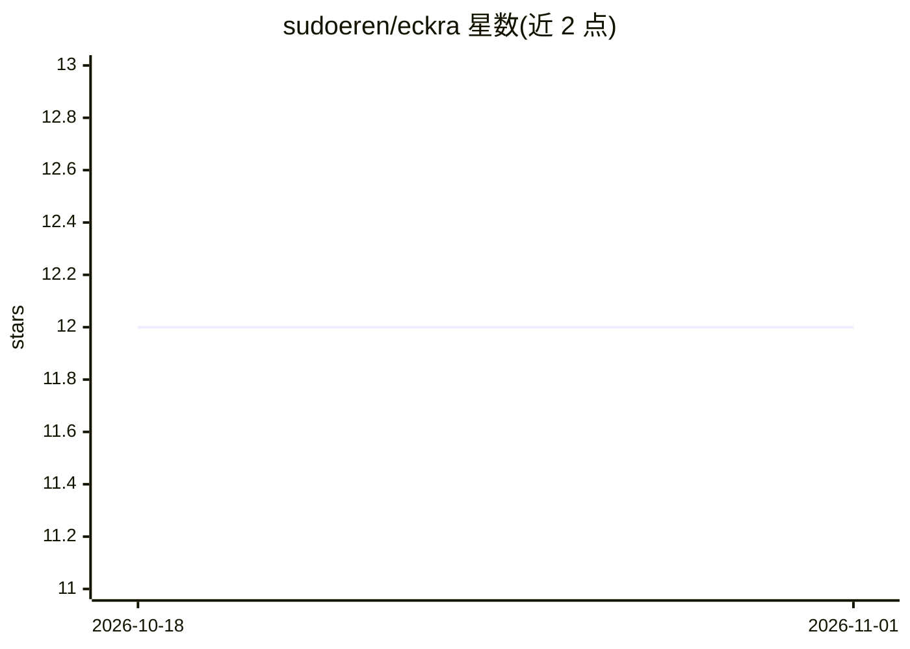

# sudoeren/eckra

⭐ 12 · JavaScript · MIT · 推送 2026-10-31 · [GitHub](https://github.com/sudoeren/eckra) · [官网](https://www.npmjs.com/package/eckra) · 个人维护

**带 AI 提交信息与项目故事的交互式 Git 管理工具**

基于 Node.js 的命令行 Git 管理工具，把暂存、分支、stash、远程与提交图整合进一个交互式面板。AI 能力包括：基于实际 diff 生成 11 种 provider（OpenAI、Anthropic、Gemini、DeepSeek、Bedrock 等）的提交信息、AI 撰写 PR 标题与描述、发布说明与项目时间线故事。默认可配合 Ollama 免 API key 使用，支持 5 种提交格式与 lazygit 集成。提供 npm、Homebrew、独立二进制与 Scoop 安装方式，npm/Homebrew 需 Node.js 22.13+。

## 筛选速览

| 维度 | 判定 | 备注 |
|---|---|---|
| AI 角色 | `ai-enhanced` | 去掉 AI 部分产品仍成立 |
| 许可风险 | `permissive` | MIT |
| 部署形态 | `desktop` | 安装包/桌面程序 |
| 模型依赖 | local-ok | 支持本地模型 |
| 硬件要求 | — | 无带数字的原话,不猜 |
| 安装摩擦 | `low` | 无编译、无系统依赖或容器化 |
| 成熟度 | — | 结构信号不足 |

## 能力要点

- 基于实际 diff 生成 AI 提交信息，支持 11 种 AI provider
- VS Code 风格的全分支提交图（Git Graph）
- AI 撰写 PR 标题/描述、发布说明与项目时间线故事
- lazygit 集成：在 lazygit 中按键触发 AI 提交流程

## 适用场景

- 让 AI 根据代码改动生成规范的提交信息
- 在一个面板里管理暂存、分支、stash 与远程
- 用 AI 生成 PR 描述与发布说明、维护 CHANGELOG

## 场景标签

`AI 写作` · 领域:内容生成

## 证据(README 行号)

> L13: eckra is an interactive, AI-powered Git management tool. It writes context-aware commit messages, turns your commit
> L23: - **AI commit messages** based on your actual diff, with 11 AI providers (OpenAI, Anthropic, Gemini, DeepSeek, Amaz

## 星数曲线

2026-10-18 12 → 2026-11-01 12（+0）

---
*卡片 v1 · prompt 1.4 · 生成 2026-10-31 · 置信度 high · 依据 README sha `7089bc9bd069` · [字段定义](../../DATASET.md)*
