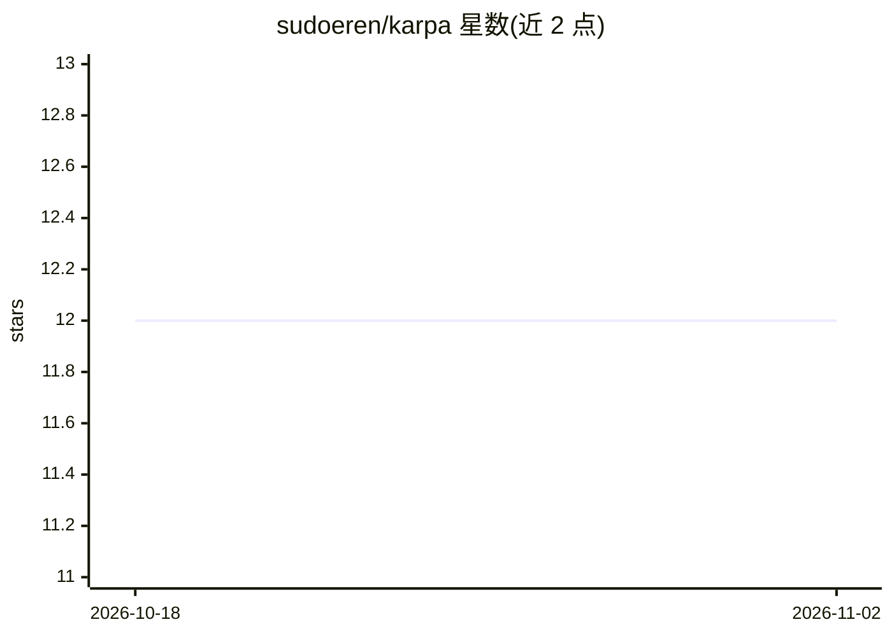

# sudoeren/karpa

⭐ 12 · TypeScript · MIT · 推送 2026-10-26 · [GitHub](https://github.com/sudoeren/karpa) · [官网](https://karpa.erencakar.com) · 个人维护

**隐私优先的本地 AI 翻译桌面应用，数据不离设备**

基于 Tauri 的原生桌面翻译应用（另有 Docker 部署的 Web 形态），支持 12+ 种语言互译，可翻译纯文本与 .txt/.md/.json/.csv/.srt 等文件，提供语气选择、历史收藏与文本转语音。翻译通过用户自选的模型服务完成：本地可接 LM Studio 或 Ollama（配合即完全离线），也可配置 OpenAI/Anthropic/Gemini/OpenRouter 的 API key。Windows/macOS/Linux 均提供安装包，也可从源码构建。

## 筛选速览

| 维度 | 判定 | 备注 |
|---|---|---|
| AI 角色 | `ai-native` | 本体是模型或模型工具 |
| 许可风险 | `permissive` | MIT |
| 部署形态 | `desktop` | 安装包/桌面程序 |
| 模型依赖 | local-ok | 支持本地模型 |
| 硬件要求 | — | 无带数字的原话,不猜 |
| 安装摩擦 | `low` | 无编译、无系统依赖或容器化 |
| 成熟度 | — | 结构信号不足 |

## 能力要点

- 支持 LM Studio、Ollama、OpenAI、Anthropic、Gemini、OpenRouter 六类模型来源
- 文本与文件翻译（.txt/.md/.json/.csv/.srt 等）及 Standard/Formal/Casual/Technical 四种语气
- 提供 Windows(.exe/.msi)、macOS(.dmg)、Linux(.deb/.AppImage/.rpm) 安装包
- 内置多语言文本转语音与翻译历史收藏

## 适用场景

- 在本地模型（LM Studio/Ollama）上离线翻译，避免数据外发
- 翻译带语气偏好的日常或技术文本
- 批量翻译 .srt 字幕或 .md/.csv 等文件

## 场景标签

`语音合成` · 领域:内容生成

## 证据(README 行号)

> L19: Karpa is a privacy-first AI translator that runs entirely on your machine.
> L24:  Supports LM Studio, Ollama, OpenAI, Anthropic, Google Gemini and OpenRouter.

## 星数曲线

2026-10-18 12 → 2026-11-02 12（+0）

---
*卡片 v1 · prompt 1.4 · 生成 2026-10-31 · 置信度 high · 依据 README sha `d66d1a2d090a` · [字段定义](../../DATASET.md)*
