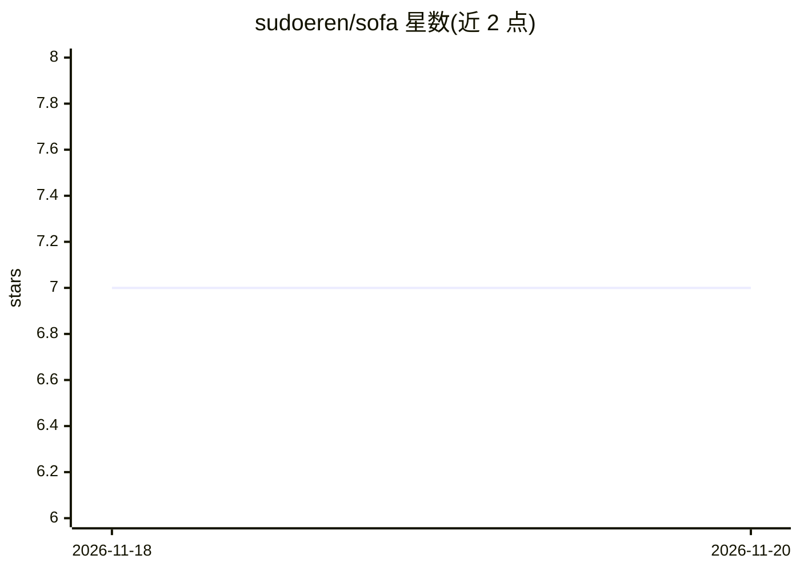

# sudoeren/sofa

⭐ 7 · TypeScript · MIT · 推送 2026-11-17 · [GitHub](https://github.com/sudoeren/sofa) · [官网](https://sofa.erencakar.com) · 个人维护

**自托管的群组协作空间：群里直接向 AI 要投票、行程、分账工具**

Sofa 是一个开源、自托管的群组协作空间：用户开一个空间并分享链接，成员可丢入笔记、链接、文件，任何人用自然语言请求工具（投票、行程、分账、淘汰赛对阵等），工具实时出现在空间中并支持多人同时编辑。内置 8 种无需 AI key 即可用的工具；其他需求由 AI 生成为运行在沙盒 iframe（禁止网络访问）中的自由工具。数据以 Yjs 文档同步并存储在 SQLite，单 Node 进程提供 Web 应用、REST API 与协作 socket。无任何 key 时按关键词匹配最接近的内置工具。

## 筛选速览

| 维度 | 判定 | 备注 |
|---|---|---|
| AI 角色 | `ai-native` | 本体是模型或模型工具 |
| 许可风险 | `permissive` | MIT |
| 部署形态 | `self-host` | docker 或自建部署 |
| 模型依赖 | local-ok | 支持本地模型 |
| 硬件要求 | — | 无带数字的原话,不猜 |
| 安装摩擦 | `low` | 无编译、无系统依赖或容器化 |
| 成熟度 | `idea` | |

## 能力要点

- 自然语言请求工具，AI 重新请求时保留已录入数据
- 内置 8 种协作工具，无 AI key 也可用
- 自由工具运行在禁止网络访问的沙盒 iframe，并检测逃逸导航
- 支持 Anthropic/OpenAI/OpenRouter 及任意 OpenAI 兼容端点，成员可自带 key

## 适用场景

- 组织聚餐、出游时发起投票与收集可参加时段
- 多人分摊旅行或住宿费用并计算结算方案
- 为小组活动生成对阵表、座位安排等定制小工具

## 场景标签

 · 领域:协作工具/群组规划

## 证据(README 行号)

> L3: Stop planning in the group chat. Ask for a poll, a trip plan, a cost splitter or a small game, and it appears for ev
> L12: have: notes, links, files. Then anyone can ask for a tool: "a poll for Friday's dinner",
> L30: Anything else, such as a small game or an unusual layout, is written by the AI as a

## 星数曲线

2026-11-18 7 → 2026-11-20 7（+0）

---
*卡片 v1 · prompt 1.4 · 生成 2026-11-20 · 置信度 mid · 依据 README sha `37c7a7449eea` · [字段定义](../../DATASET.md)*
