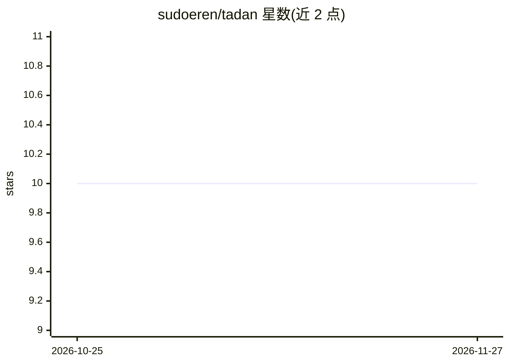

# sudoeren/tadan

⭐ 10 · TypeScript · NOASSERTION · 推送 2026-09-18 · [GitHub](https://github.com/sudoeren/tadan) · [官网](https://tadan.erencakar.com) · 个人维护

**给广告投放者的 AI 广告合规扫描器**

面向媒体投放者的开源广告合规工具：用户输入广告文案或落地页 URL，Critic Agent 基于 RAG 检索的 Meta、Google、TikTok、Taboola 政策规则输出违规项与 0–100 风险评分，Optimizer Agent 在有违规时生成改写变体。政策库为 4 个平台的版本化规则快照，用 text-embedding-3-small 嵌入存入 pgvector，首次调用自动播种。技术栈为 Next.js 16 + Bun + PostgreSQL 16 + pgvector，LLM 走 OpenRouter API，仅支持桌面端。

## 筛选速览

| 维度 | 判定 | 备注 |
|---|---|---|
| AI 角色 | `ai-native` | 本体是模型或模型工具 |
| 许可风险 | `none` | NOASSERTION |
| 部署形态 | `self-host` | docker 或自建部署 |
| 模型依赖 | locked-api |  |
| 硬件要求 | — | 无带数字的原话,不猜 |
| 安装摩擦 | `low` | 无编译、无系统依赖或容器化 |
| 成熟度 | — | 结构信号不足 |

## 能力要点

- RAG 检索 top-5 相似政策规则注入 Critic Agent，返回结构化违规与风险分
- Optimizer Agent 按不同心理角度生成广告文案改写变体
- 抓取器内置 SSRF 防护（DNS 解析、私网 IP 拦截、重定向上限）
- predev 钩子自动启动 Postgres+pgvector 容器并应用迁移，无手动设置

## 适用场景

- 投放广告前检查文案是否违反平台政策
- 扫描落地页 URL 获取合规分析
- 获取广告文案的改写建议以规避违规点

## 场景标签

`RAG` · 领域:知识与检索

## 证据(README 行号)

> L5:  AI-first ad compliance for media buyers — open source.
> L24: - **Critic Agent**: A senior ad compliance officer system prompt. Receives either RAG-matched policy rules (top-5 m
> L35: Policy rules are embedded via `openai/text-embedding-3-small` and stored in pgvector. At scan time, the user's ad c

## 星数曲线

2026-10-25 10 → 2026-11-27 10（+0）

---
*卡片 v1 · prompt 1.4 · 生成 2026-11-19 · 置信度 high · 依据 README sha `15d5767b1145` · [字段定义](../../DATASET.md)*
