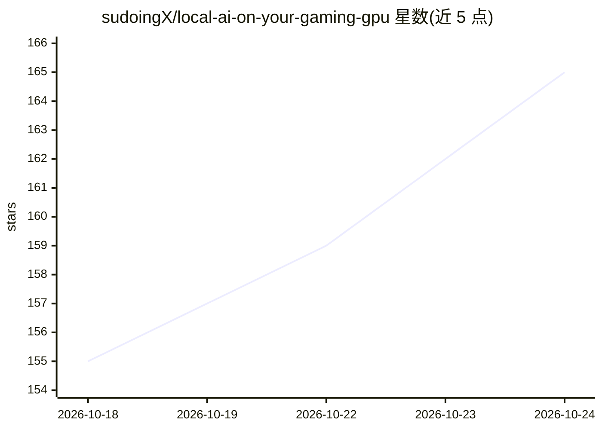

# sudoingX/local-ai-on-your-gaming-gpu

⭐ 165 · Python · 推送 2026-10-17 · [GitHub](https://github.com/sudoingX/local-ai-on-your-gaming-gpu) · 个人维护

**一行命令在游戏显卡上本地运行 27B 模型的一体化安装器**

面向拥有 RTX 20/30/40/50 及 AMD Radeon（beta）显卡、显存 8GB 以上的用户的本地 LLM 部署工具：一条 PowerShell 或 curl 命令自动识别显卡、从 Hugging Face 下载预构建的 llama.cpp 分支运行包与模型文件（约 8GB，SHA256 校验）并启动服务。提供浏览器聊天界面（127.0.0.1:8899）与 OpenAI 兼容 API。默认模型为 Ternary Bonsai 2 27B（Qwen 3.8 27B 三值量化，含 MTP 推测解码），另有同模型的 Offrail 无审查构建可选。预构建包无需编译器，按显存分档提供 serve 脚本与上下文长度。

## 筛选速览

| 维度 | 判定 | 备注 |
|---|---|---|
| AI 角色 | `ai-ecosystem` | LLM/agent 周边工具 |
| 许可风险 | `none` | — |
| 部署形态 | `library` | 以包/库形式分发 |
| 模型依赖 | local-ok | 支持本地模型 |
| 硬件要求 | — | 无带数字的原话,不猜 |
| 安装摩擦 | `high` | 编译与系统依赖俱全 |
| 成熟度 | `idea` | |

## 能力要点

- 一键安装脚本自动识别显卡并下载对应的预构建包与模型
- 提供浏览器聊天 UI 与 OpenAI 兼容 API（/v1）
- 按显存分档（8/12/16GB+）的 serve 脚本与上下文窗口配置，最高 262K
- 可选 Offrail 27B 无审查构建（同一安装器，一个标志切换）

## 适用场景

- 用现有游戏显卡本地跑一个 27B 模型，浏览器直接对话
- 把本地 OpenAI 兼容 API 接给自己的 agent 或客户端
- 用附带脚本测量自己显卡的推理速度并提交结果

## 场景标签

`推理引擎` · 领域:训练与推理

## 证据(README 行号)

> L26: its SHA256) and starts it. Chat in your browser at `http://127.0.0.1:8899`, or point any agent at
> L27: `http://127.0.0.1:8899/v1` (OpenAI compatible, model `bonsai-2-27b`). On Windows a desktop shortcut starts it again
> L118: `serve-8gb.sh`. Then open `http://localhost:8899`: the llama.cpp chat UI, and an OpenAI-compatible API at `/v1`.

## 星数曲线

2026-10-18 155 → 2026-10-24 165（+10）

---
*卡片 v1 · prompt 1.4 · 生成 2026-10-22 · 置信度 mid · 依据 README sha `7b4c7a8161ab` · [字段定义](../../DATASET.md)*
