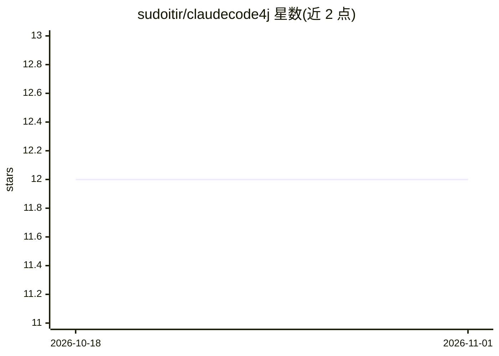

# sudoitir/claudecode4j

⭐ 12 · Java · MIT · 推送 2026-10-26 · [GitHub](https://github.com/sudoitir/claudecode4j) · 个人维护

**Java 库：在 Java/Spring 应用中集成并调用 Claude Code CLI**

面向 Java 开发者的 Claude Code CLI 集成库：提供纯 Java API（sealed 类型与 records）、基于 Virtual Threads 与结构化并发的执行模型、Spring Boot 4 自动配置（健康检查与 Micrometer 指标）。适配层包括 REST/SSE 端点（含 OpenAI 兼容 /v1/chat/completions 与 Anthropic 兼容 /v1/messages）、Kafka request-reply 适配器、WebSocket 交互终端及 MCP Server（将 Java 方法暴露为 Claude 工具）。以 Maven 多模块形式分发，需 Java 25+、Maven 3.9+ 且本机已安装 Claude Code CLI。

## 筛选速览

| 维度 | 判定 | 备注 |
|---|---|---|
| AI 角色 | `ai-ecosystem` | LLM/agent 周边工具 |
| 许可风险 | `permissive` | MIT |
| 部署形态 | `library` | 以包/库形式分发 |
| 模型依赖 | locked-api |  |
| 硬件要求 | — | 无带数字的原话,不猜 |
| 安装摩擦 | `medium` | 含编译或系统依赖之一 |
| 成熟度 | — | 结构信号不足 |

## 能力要点

- REST 适配器提供 OpenAI 兼容与 Anthropic 兼容端点
- Kafka request-reply 适配器（correlation ID 关联请求与响应）
- MCP Server：将 Java 方法暴露为 Claude 工具
- Spring Boot 4 自动配置、健康检查与 Micrometer 指标

## 适用场景

- 在 Spring Boot 服务中调用 Claude Code CLI 执行编码任务
- 通过 OpenAI/Anthropic 兼容 HTTP 端点让现有工具接入 Claude Code
- 用 Kafka 解耦跨服务的 Claude 请求-应答调用

## 场景标签

`编码 Agent` · 领域:编码与开发

## 证据(README 行号)

> L16:  A modern Java library for integrating with Claude Code CLI — Anthropic's agentic coding tool.
> L29: - **MCP Server** - Expose Java methods as Claude tools via Model Context Protocol
> L231: The REST adapter includes an **OpenAI-compatible** `/v1/chat/completions` endpoint, allowing tools and application

## 星数曲线

2026-10-18 12 → 2026-11-01 12（+0）

---
*卡片 v1 · prompt 1.4 · 生成 2026-10-31 · 置信度 mid · 依据 README sha `950cb85d1c8e` · [字段定义](../../DATASET.md)*
