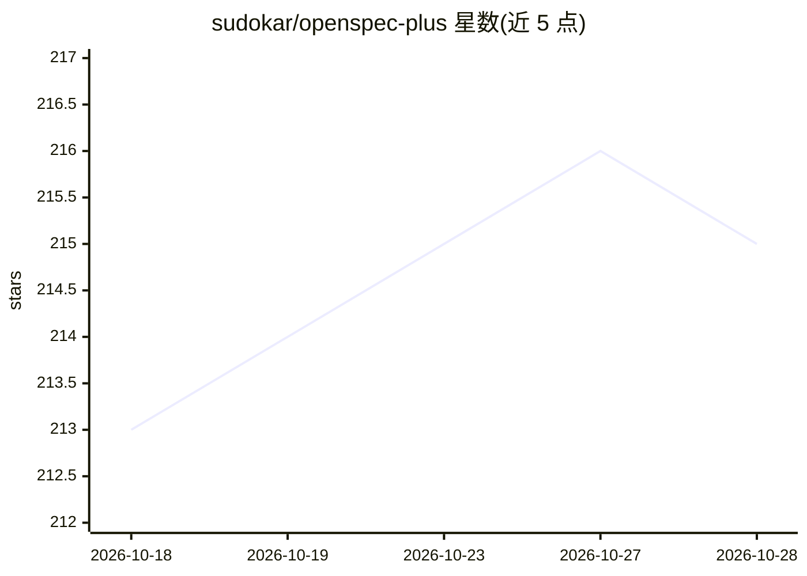

# sudokar/openspec-plus

⭐ 215 · MIT · 推送 2026-09-03 · [GitHub](https://github.com/sudokar/openspec-plus) · [官网](https://github.com/sudokar/openspec-plus) · 个人维护

**增强 OpenSpec 规范驱动开发的 agent 技能集**

为 OpenSpec 规范驱动开发工作流提供的一组 agentic 技能，覆盖 Proposal、Spec、Design、Tasks、Apply、TDD 六个阶段，强调结构化需求发现、可测试验收场景、设计备选方案权衡与按切片的质量门禁。设计为嵌入现有 OpenSpec 工作流而非替代。兼容 OpenCode、Claude Code、Windsurf/Devin、Cursor、GitHub Copilot 等编码 agent。安装方式为向编码 agent 粘贴一段安装提示词自动下载配置，或手动 git clone 后复制技能文件；前置条件是项目中已运行 openspec init。通过 openspec/.plus/config.yaml 提供可选配置（问题模式、自动更新检查、执行模式等）。

## 筛选速览

| 维度 | 判定 | 备注 |
|---|---|---|
| AI 角色 | `ai-ecosystem` | LLM/agent 周边工具 |
| 许可风险 | `permissive` | MIT |
| 部署形态 | `None` |  |
| 模型依赖 | — | README 未给出锁定关系 |
| 硬件要求 | — | 无带数字的原话,不猜 |
| 安装摩擦 | `low` | 无编译、无系统依赖或容器化 |
| 成熟度 | — | 结构信号不足 |

## 能力要点

- 覆盖六阶段（Proposal/Spec/Design/Tasks/Apply/TDD）的结构化技能
- 兼容多种 AI 编码 agent（OpenCode、Claude Code、Cursor、GitHub Copilot 等）
- 粘贴提示词即可自动安装/更新，也提供手动安装步骤
- openspec/.plus/config.yaml 可选配置（batch 问题模式、subagent/inline 执行等）

## 适用场景

- 在 OpenSpec 项目中让编码 agent 按结构化流程做需求发现与规格编写
- 为 AI 编码 agent 增加测试优先与按切片验证的执行纪律
- 已有 OpenSpec 工作流上叠加设计决策权衡与质量门禁

## 场景标签

`编码 Agent` · 领域:编码与开发

## 证据(README 行号)

> L3:  Agentic skills for OpenSpec that enforce deep discovery, testable specs, validated design, and disciplined executio
> L20: OpenSpec defines the workflow. OpenSpec Plus enforces the structure and discipline. It's designed to fit into the e

## 星数曲线

2026-10-18 213 → 2026-10-28 215（+2）

---
*卡片 v1 · prompt 1.4 · 生成 2026-10-22 · 置信度 high · 依据 README sha `567845e20631` · [字段定义](../../DATASET.md)*
