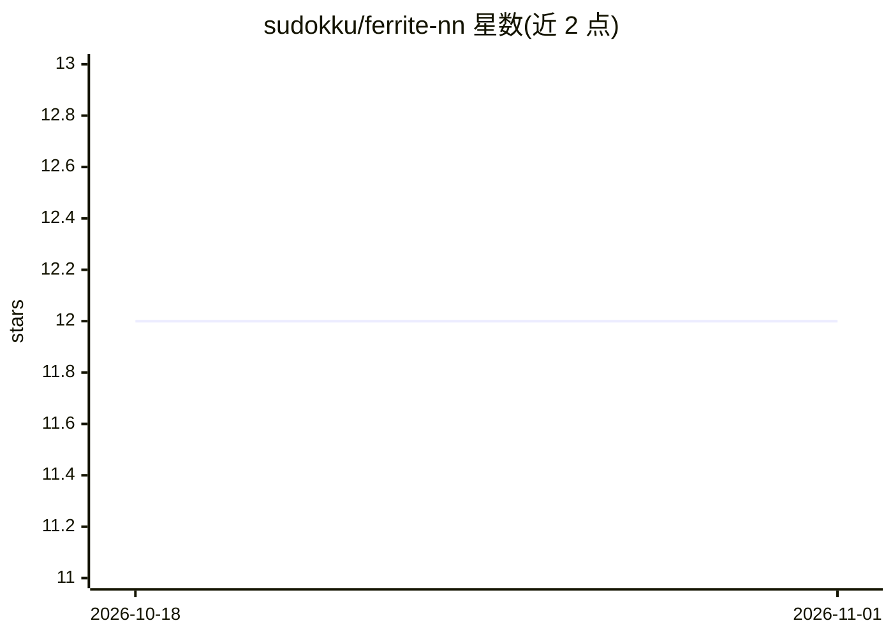

# sudokku/ferrite-nn

⭐ 12 · Rust · 推送 2026-03-05 · [GitHub](https://github.com/sudokku/ferrite-nn) · 个人维护

**纯 Rust 从零实现的神经网络库，附 JSON REST API 训练服务**

不依赖 PyTorch/TensorFlow 等外部 ML 框架、以矩阵运算与反向传播从零实现的 Rust 神经网络库，组织为 Cargo workspace：核心 ML 库 crate 与本地 studio server crate。核心库提供多种激活/损失函数、训练循环、JSON 序列化、MNIST IDX 格式解析与图像预处理；studio server 在 127.0.0.1:7878 暴露 JSON REST API，处理训练任务、SSE 进度流、数据集上传、推理与评估。示例含 XOR 与 MNIST（约 97% 测试准确率）。需 Rust 1.75+，最小推理 GUI 尚未实现。

## 筛选速览

| 维度 | 判定 | 备注 |
|---|---|---|
| AI 角色 | `ai-native` | 本体是模型或模型工具 |
| 许可风险 | `none` | — |
| 部署形态 | `None` |  |
| 模型依赖 | — | README 未给出锁定关系 |
| 硬件要求 | — | 无带数字的原话,不猜 |
| 安装摩擦 | `low` | 无编译、无系统依赖或容器化 |
| 成熟度 | — | 结构信号不足 |

## 能力要点

- 无外部 ML 依赖，从矩阵与反向传播实现核心 NN 原语
- studio server 以 JSON REST API 提供训练/推理/评估与 SSE 进度流
- 模型保存/加载为 JSON，嵌入自描述元数据（输入类型）
- 内置 MNIST IDX 解析器与图像预处理（Lanczos3 缩放、归一化）

## 适用场景

- 在 Rust 项目中以路径依赖方式训练和运行小型神经网络
- 通过浏览器前端或 HTTP 客户端远程发起训练与推理
- 学习神经网络底层实现（反向传播、激活/损失函数）

## 场景标签

`模型训练` · 领域:训练与推理

## 证据(README 行号)

> L3: A neural network library built from scratch in Rust — no PyTorch, no TensorFlow, no external ML
> L6: `ferrite-nn` is structured as a Cargo workspace with two crates: the core ML library and a local

## 星数曲线

2026-10-18 12 → 2026-11-01 12（+0）

---
*卡片 v1 · prompt 1.4 · 生成 2026-10-31 · 置信度 high · 依据 README sha `59612bb0f7d2` · [字段定义](../../DATASET.md)*
