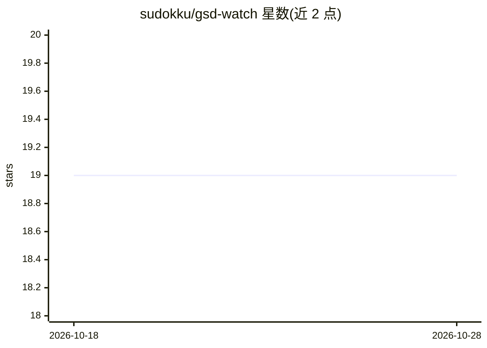

# sudokku/gsd-watch

⭐ 19 · Go · 推送 2026-05-09 · [GitHub](https://github.com/sudokku/gsd-watch) · 个人维护

**终端侧边栏：实时展示 GSD + Claude Code 项目阶段与进度**

用 Go（Bubble Tea）编写的只读 tmux/cmux 侧边栏，监控 GSD v1 项目 .planning/ 目录，实时渲染阶段树、计划、状态图标与生命周期徽章（Discussed/Researched/Planned/Executed 等）；基于 fsnotify 递归监听、300ms 防抖，文件变更后 1 秒内刷新，无需轮询。需 tmux 或 cmux 运行、Claude Code 在会话内、GSD v1 项目存在 .planning/ 目录；cmux 仅支持 macOS。提供预编译二进制下载与 /gsd-watch 斜杠命令集成，也可 make 从源码构建。

## 筛选速览

| 维度 | 判定 | 备注 |
|---|---|---|
| AI 角色 | `ai-ecosystem` | LLM/agent 周边工具 |
| 许可风险 | `none` | — |
| 部署形态 | `None` |  |
| 模型依赖 | — | README 未给出锁定关系 |
| 硬件要求 | — | 无带数字的原话,不猜 |
| 安装摩擦 | `high` | 编译与系统依赖俱全 |
| 成熟度 | — | 结构信号不足 |

## 能力要点

- fsnotify 递归监听 .planning/，300ms 防抖实时刷新
- 阶段生命周期徽章映射到对应 GSD 生命周期文件
- 静态二进制，无 CGO，运行时仅依赖 tmux 或 cmux
- 通过 /gsd-watch 斜杠命令在 Claude Code 会话中打开 35% 宽侧栏

## 适用场景

- 在 Claude Code 多阶段工作流中随时查看当前所处阶段
- 不切换上下文即可跟踪 GSD 项目计划与执行进度
- 按生命周期文件确认各阶段完成状态

## 场景标签

 · 领域:开发者工具/终端 UI

## 证据(README 行号)

> L13: A read-only tmux/cmux sidebar that renders your GSD project tree live — phases, plans, status icons, and lifecycle 
> L27: - **Claude Code** running inside a tmux or cmux session

## 星数曲线

2026-10-18 19 → 2026-10-28 19（+0）

---
*卡片 v1 · prompt 1.4 · 生成 2026-10-28 · 置信度 high · 依据 README sha `77cbcb2fcab3` · [字段定义](../../DATASET.md)*
