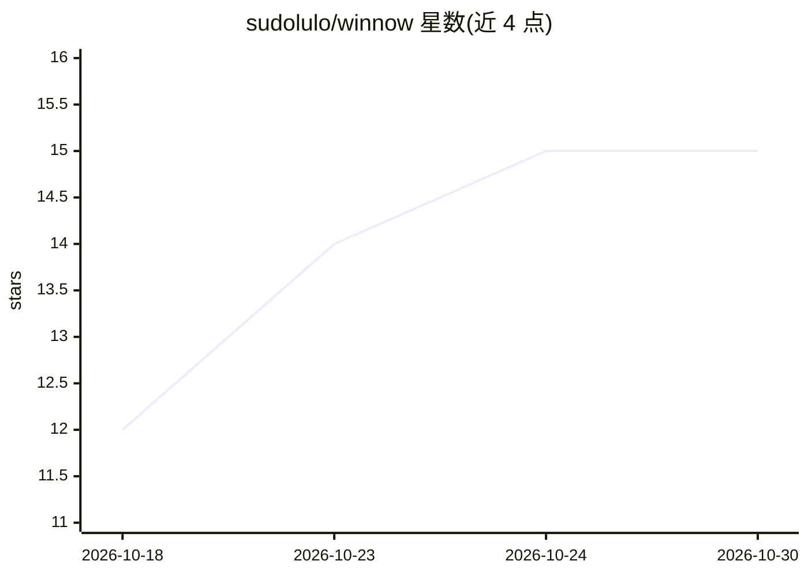

# sudolulo/winnow

⭐ 15 · Python · AGPL-3.0 · 推送 2026-10-29 · [GitHub](https://github.com/sudolulo/winnow) · [官网](https://github.com/sudolulo/winnow/wiki) · 个人维护

**从 Immich 照片库筛选多样化人脸训练数据供 Frigate 使用**

自托管 Docker 工具：通过 Immich API 读取照片库，用 InsightFace Buffalo_L 嵌入挑选每人最具多样性、高质量的图像子集（adaptive/standard/broad 三种策略），对齐为 ArcFace 112×112 格式后上传至 Frigate 作为人脸识别训练数据。只修改自己上传的文件，不触碰 Frigate 中手动添加的图像；上传与拒绝记录持久化避免重复处理。提供 NVIDIA CUDA/AMD ROCm/Intel OpenVINO/CPU 四种镜像，支持 cron 定时。作者声明处于早期开发阶段，部分清理功能未经大规模验证。

## 筛选速览

| 维度 | 判定 | 备注 |
|---|---|---|
| AI 角色 | `ai-ecosystem` | LLM/agent 周边工具 |
| 许可风险 | `viral` | AGPL-3.0 |
| 部署形态 | `None` |  |
| 模型依赖 | — | README 未给出锁定关系 |
| 硬件要求 | `cpu-ok` | |
| 安装摩擦 | `medium` | 含编译或系统依赖之一 |
| 成熟度 | `idea` | |

## 能力要点

- 基于 AI 嵌入的多样性选图，三种选择策略
- 仅管理自己上传的文件，不删除 Frigate 手动训练数据
- 四种 Docker 镜像（CUDA/ROCm/OpenVINO/CPU）与 cron 调度
- ArcFace 112×112 对齐、模糊阈值、置信度过滤等质量参数

## 适用场景

- 为 Frigate 人脸识别补充识别对象不足的训练图片
- 从现有 Immich 照片库自动挑选多样化人脸数据集
- 定时自动同步并维护 Frigate 训练数据

## 场景标签

`人脸识别` · 领域:感知与多模态

## 证据(README 行号)

> L12: `winnow` pulls photos from your Immich library, selects the most diverse and highest-quality subset using AI embedd
> L134: |`ENABLE_FACE_ALIGNMENT`|`true`|Align to ArcFace 112×112 format using facial landmarks|

## 星数曲线

2026-10-18 12 → 2026-10-30 15（+3）

---
*卡片 v1 · prompt 1.4 · 生成 2026-10-30 · 置信度 high · 依据 README sha `5722143709b0` · [字段定义](../../DATASET.md)*
