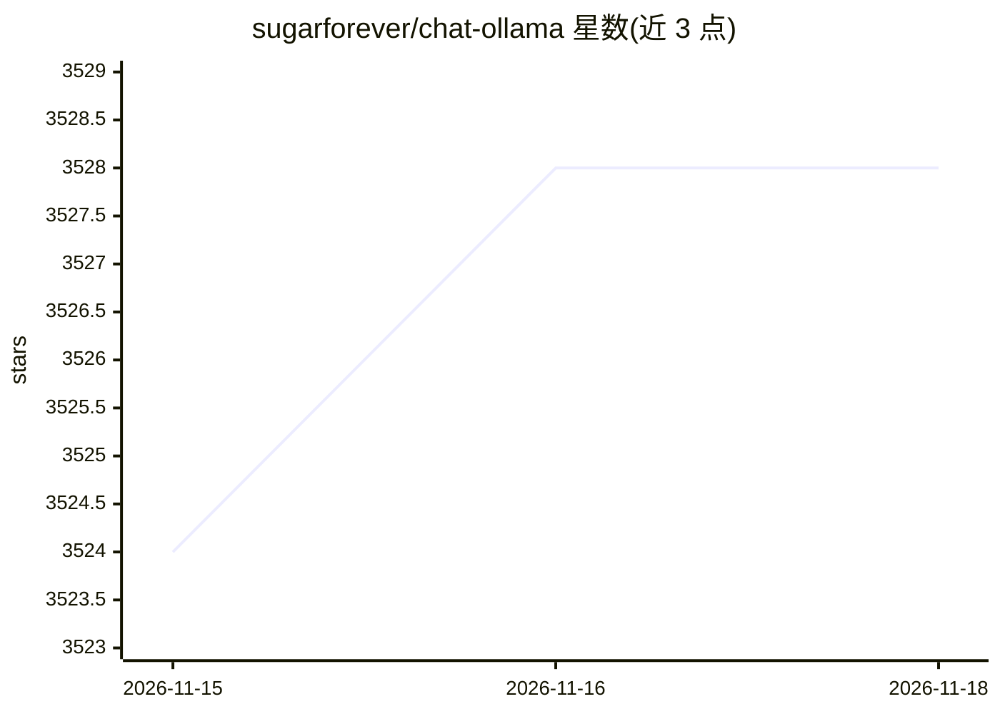

# sugarforever/chat-ollama

⭐ 3,528 · TypeScript · NOASSERTION · 推送 2026-11-16 · [GitHub](https://github.com/sugarforever/chat-ollama) · 组织维护

**自托管 AI agent 对话应用：本地/托管模型加文档知识库**

基于 Pi Durable 与 SvelteKit 的开源 agentic Web 应用，面向自托管用户：通过 OpenAI 兼容端点连接本地或托管模型（含 Ollama），支持持久化对话（关浏览器后任务继续）、上传 PDF/Markdown/纯文本构建带来源引用的知识库、内置文件与 shell 工具，并可通过 Model Context Protocol 接入本地/远程工具及安装可复用技能。数据本地存储于 SQLite 与文件，无需独立数据库或向量服务；应用无登录功能。需 Node.js 24 与 pnpm 从源码构建运行。

## 筛选速览

| 维度 | 判定 | 备注 |
|---|---|---|
| AI 角色 | `ai-native` | 本体是模型或模型工具 |
| 许可风险 | `none` | NOASSERTION |
| 部署形态 | `library` | 以包/库形式分发 |
| 模型依赖 | local-ok | 支持本地模型 |
| 硬件要求 | — | 无带数字的原话,不猜 |
| 安装摩擦 | `low` | 无编译、无系统依赖或容器化 |
| 成熟度 | — | 结构信号不足 |

## 能力要点

- OpenAI 兼容端点连接本地/托管模型，会话内可切换模型
- PDF/Markdown/纯文本知识库问答并附来源引用
- MCP 接入本地与远程工具，支持技能安装
- SQLite 与文件本地存储，无需独立数据库或向量服务

## 适用场景

- 自托管一个可跨本地与托管模型的 agent 对话界面
- 上传文档建立带来源引用的私有知识库问答
- 通过 MCP 把本地/远程工具接入 agent 使用

## 场景标签

`文档问答` `AI 助手` · 领域:对话与助手

## 证据(README 行号)

> L3: ChatOllama is an open source agentic app for running AI agents across local and
> L11: - **Chat with your choice of model:** connect AI providers or local models through
> L15: - **Document knowledge bases:** upload PDF, Markdown, and plain-text documents,

## 星数曲线

2026-11-15 3,524 → 2026-11-18 3,528（+4）

---
*卡片 v1 · prompt 1.4 · 生成 2026-11-17 · 置信度 mid · 依据 README sha `b03e1a77ad4e` · [字段定义](../../DATASET.md)*
