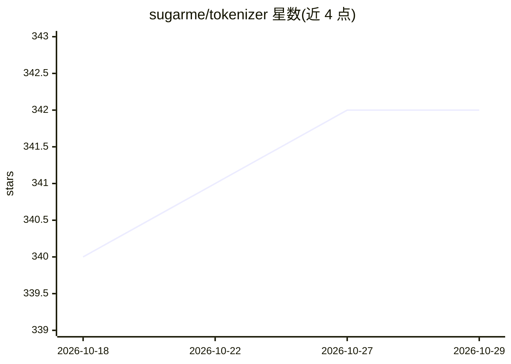

# sugarme/tokenizer

⭐ 342 · Go · Apache-2.0 · 推送 2026-05-26 · [GitHub](https://github.com/sugarme/tokenizer) · 个人维护

**Go 语言 NLP 分词库：加载/训练 Word、WordPiece、BPE 模型**

纯 Go 编写的分词器库，用于在 Go 中应用 NLP 模型的训练、测试与推理，模块包括 Normalizer、PreTokenizer、Tokenizer 与后处理，实现 Word level、WordPiece 与 BPE 模型，支持从头训练或微调。受 HuggingFace Tokenizers 启发并借鉴其概念，兼容从 HuggingFace 加载预训练模型，部分可经 pretrained 子包加载，也可手动从文件加载。Apache 2.0 许可，是 gotch/transformer 生态的一部分。

## 筛选速览

| 维度 | 判定 | 备注 |
|---|---|---|
| AI 角色 | `ai-ecosystem` | LLM/agent 周边工具 |
| 许可风险 | `permissive` | Apache-2.0 |
| 部署形态 | `None` |  |
| 模型依赖 | — | README 未给出锁定关系 |
| 硬件要求 | — | 无带数字的原话,不猜 |
| 安装摩擦 | `low` | 无编译、无系统依赖或容器化 |
| 成熟度 | — | 结构信号不足 |

## 能力要点

- 实现 Word level、WordPiece、BPE 三种分词模型
- 兼容从 HuggingFace 加载预训练模型（pretrained 子包）
- 支持从头训练或微调分词模型
- 纯 Go 实现，无外部运行时依赖

## 适用场景

- Go 项目中做 NLP 分词与模型推理预处理
- 加载 HuggingFace 预训练分词器到 Go 服务
- 在 Go 中训练或微调 BPE/WordPiece 模型

## 场景标签

 · 领域:NLP 工具库

## 证据(README 行号)

> L5: `tokenizer` is pure Go package to facilitate applying Natural Language Processing (NLP) models train/test and infere
> L9: `tokenizer` is part of an ambitious goal (together with **transformer** and **gotch**) to bring more AI/deep-learnin

## 星数曲线

2026-10-18 340 → 2026-10-29 342（+2）

---
*卡片 v1 · prompt 1.4 · 生成 2026-10-21 · 置信度 high · 依据 README sha `7904dac8bed3` · [字段定义](../../DATASET.md)*
