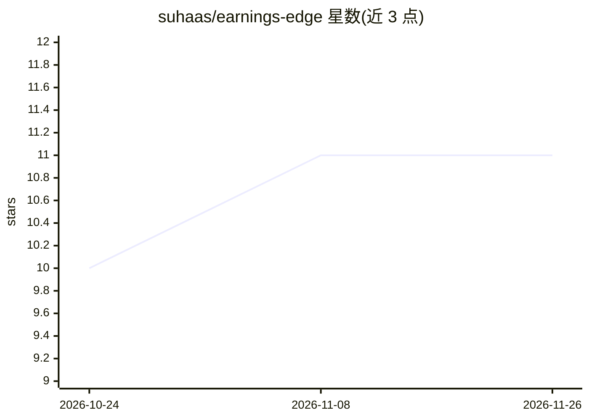

# suhaas/earnings-edge

⭐ 11 · Python · 推送 2026-09-25 · [GitHub](https://github.com/suhaas/earnings-edge) · 个人维护

**多 Agent 管线：把财报电话会转成带出处的分析师简报**

基于 LangGraph 编排的多 Agent 应用：拉取财报电话会记录与 SEC 文件，用本地 FinBERT 打分管理层语气，抽取 KPI 与分析师共识对比，融合成可解释的 SurpriseSignal，生成 Markdown 简报并经 LLM-as-judge 忠实度门检查幻觉，可选通过 Composio 推送至 Gmail/Slack/Notion。需要 ANTHROPIC_API_KEY；免费层仅支持 AAPL/MSFT 记录，其他股票需 EarningCall API key。运行需 Python 3.11+ 与 uv。

## 筛选速览

| 维度 | 判定 | 备注 |
|---|---|---|
| AI 角色 | `ai-native` | 本体是模型或模型工具 |
| 许可风险 | `none` | — |
| 部署形态 | `self-host` | docker 或自建部署 |
| 模型依赖 | locked-api |  |
| 硬件要求 | `cpu-ok` | |
| 安装摩擦 | `low` | 无编译、无系统依赖或容器化 |
| 成熟度 | — | 结构信号不足 |

## 能力要点

- LangGraph 多 Agent 管线：摄取→情绪+KPI→综合→评估→交付
- 本地 FinBERT 情绪打分，CPU 运行、无需 API key
- 每个数字标注来源事实，LLM-as-judge 忠实度门与自修订循环
- SQLite/PostgreSQL 检查点支持中断恢复

## 适用场景

- 把某公司某季度财报电话会快速整理成带出处的简报
- 对管理层语气与业绩指引偏差做可解释信号分析
- 把生成的简报自动分发到邮箱或团队协作工具

## 场景标签

`金融量化` · 领域:学习与行业

## 证据(README 行号)

> L8: **earnings-edge** runs a small team of specialized agents over
> L13: hallucinations, and (optionally) emails it.
> L24: - **Local sentiment** — FinBERT (`ProsusAI/finbert`) tone + hedging/certainty; runs on CPU, no API key

## 星数曲线

2026-10-24 10 → 2026-11-26 11（+1）

---
*卡片 v1 · prompt 1.4 · 生成 2026-11-18 · 置信度 mid · 依据 README sha `28a18bb2eeea` · [字段定义](../../DATASET.md)*
