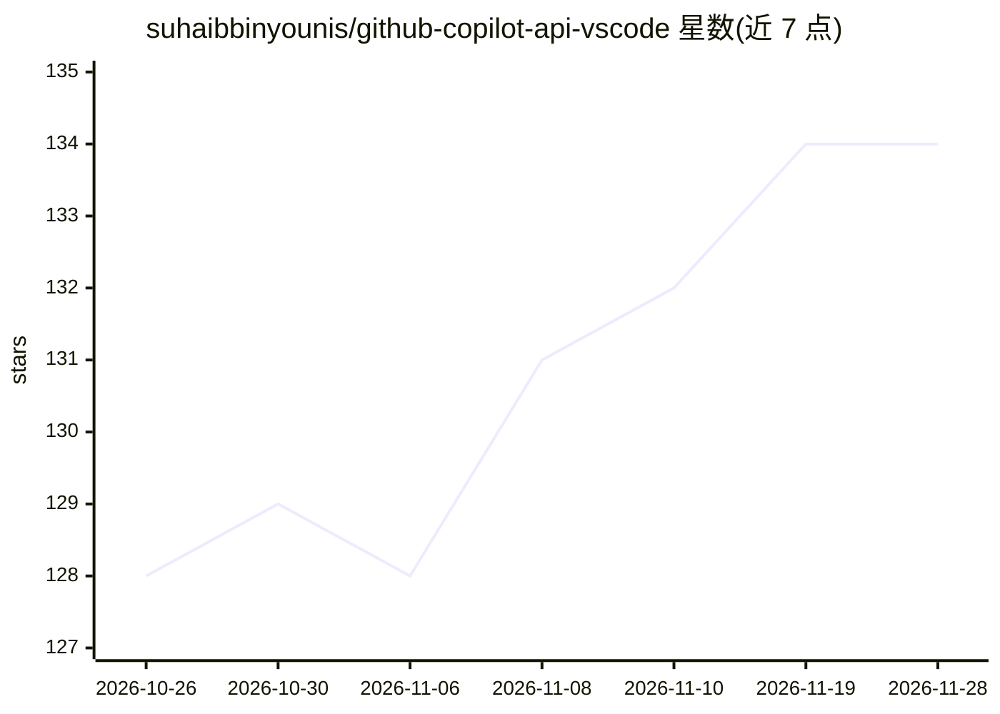

# suhaibbinyounis/github-copilot-api-vscode

⭐ 134 · TypeScript · MIT · 推送 2026-11-24 · [GitHub](https://github.com/suhaibbinyounis/github-copilot-api-vscode) · [官网](https://copilot-api.suhaib.in) · 个人维护

**把 GitHub Copilot 等模型转为本地 OpenAI 兼容 API 的 VS Code 扩展**

一个 VS Code 扩展，在本机启动 API 服务器（默认 localhost:3030），自动发现 VS Code 中注册的模型（Copilot、Gemini Code Assist、Ollama 扩展及任何 vscode.lm API 扩展），暴露 OpenAI、Anthropic、Gemini 兼容端点及 MCP 工具调用端点，供 Cursor、LangChain、Aider 等 OpenAI 兼容工具调用。支持流式输出、多模型路由、可选 API key 认证、Cloudflare Tunnel 公网访问。依赖 VS Code 1.95+ 与已登录的 Copilot Chat 扩展，VS Code 关闭则网关停止。

## 筛选速览

| 维度 | 判定 | 备注 |
|---|---|---|
| AI 角色 | `ai-ecosystem` | LLM/agent 周边工具 |
| 许可风险 | `permissive` | MIT |
| 部署形态 | `None` |  |
| 模型依赖 | local-ok | 支持本地模型 |
| 硬件要求 | — | 无带数字的原话,不猜 |
| 安装摩擦 | `low` | 无编译、无系统依赖或容器化 |
| 成熟度 | — | 结构信号不足 |

## 能力要点

- 自动发现 VS Code 内所有注册模型并暴露于 GET /v1/models
- 同时提供 OpenAI、Anthropic、Gemini 兼容端点与 MCP 工具调用
- 支持 Cloudflare Tunnel 一键公网暴露与可选 Bearer 认证
- 提供 copilot-* 模型别名以规避 Cursor 模型名拦截

## 适用场景

- 让 Cursor 使用 Copilot、Gemini 或本地 Ollama 模型作后端
- 本地运行 LangChain/AutoGPT/CrewAI agent 而不另付 API 费用
- 把 WhatsApp/Telegram 等消息平台的 Clawdbot 机器人接上 Copilot 模型
- 通过隧道在手机或远程设备上访问本机模型 API

## 场景标签

`模型网关` · 领域:Agent 开发

## 证据(README 行号)

> L1: GitHub Copilot API Gateway
> L6:  One extension. Zero API keys. Auto-discovers every model. Works with LangChain, Cursor, Aider, and 50+ tools.
> L106: All models are exposed at `GET /v1/models` and routable via the `model` field in any request. No config changes ne

## 星数曲线

2026-10-26 128 → 2026-11-28 134（+6）

---
*卡片 v1 · prompt 1.4 · 生成 2026-11-28 · 置信度 high · 依据 README sha `e48bbe3e5902` · [字段定义](../../DATASET.md)*
