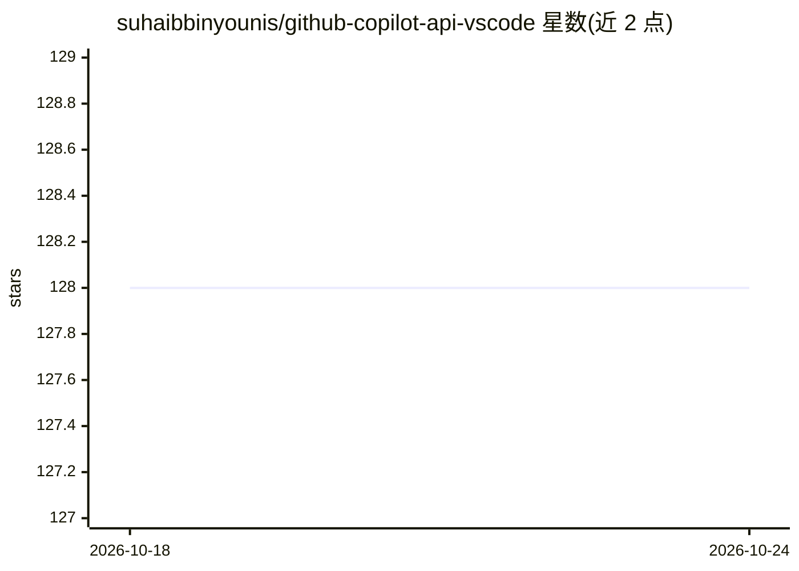

# suhaibbinyounis/github-copilot-api-vscode

⭐ 128 · TypeScript · MIT · 推送 2026-10-24 · [GitHub](https://github.com/suhaibbinyounis/github-copilot-api-vscode) · [官网](https://copilot-api.suhaib.in) · 个人维护

**把 GitHub Copilot 等 VS Code AI 变成本地 OpenAI 兼容 API 网关**

VS Code 扩展：在本地 3030 端口启动 OpenAI 兼容 API 服务器，通过 vscode.lm API 自动发现已注册的 AI 模型（Copilot、Gemini Code Assist、Ollama 扩展等），供 Cursor、LangChain、Aider 等 OpenAI 兼容工具调用，无需另配 API key。提供 /v1/chat/completions、Claude 兼容 /v1/messages、Gemini 兼容端点及工具调用/MCP 列表端点。限制：VS Code 须保持运行，需 VS Code 1.95+ 且已登录 Copilot Chat 扩展；非 GitHub/Microsoft 官方项目。

## 筛选速览

| 维度 | 判定 | 备注 |
|---|---|---|
| AI 角色 | `ai-ecosystem` | LLM/agent 周边工具 |
| 许可风险 | `permissive` | MIT |
| 部署形态 | `None` |  |
| 模型依赖 | local-ok | 支持本地模型 |
| 硬件要求 | — | 无带数字的原话,不猜 |
| 安装摩擦 | `low` | 无编译、无系统依赖或容器化 |
| 成熟度 | — | 结构信号不足 |

## 能力要点

- 自动发现 VS Code 内注册的所有 AI 模型并经 /v1/models 暴露
- 兼容 OpenAI、Anthropic Claude、Google Gemini 三类端点格式
- 提供 /v1/tools、/v1/mcp/servers 端点支持 VS Code 与 MCP 工具调用
- 内置 Cloudflare Tunnel 一键获得公网访问地址，遥测可选可关闭

## 适用场景

- 用现有 Copilot 订阅在 Cursor 中调用多种模型
- 让 LangChain、Aider 等工具零 API key 本地跑通
- 通过公网隧道从手机访问本机 AI API

## 场景标签

`模型网关` · 领域:Agent 开发

## 证据(README 行号)

> L5:  Use GitHub Copilot, Gemini, Ollama & any VS Code AI — like any other API.
> L97: This gateway **auto-discovers all AI models** registered in VS Code — not just Copilot.
> L106: All models are exposed at `GET /v1/models` and routable via the `model` field in any request. No config changes ne

## 星数曲线

2026-10-18 128 → 2026-10-24 128（+0）

---
*卡片 v1 · prompt 1.4 · 生成 2026-10-22 · 置信度 high · 依据 README sha `a41ea8b93aa2` · [字段定义](../../DATASET.md)*
