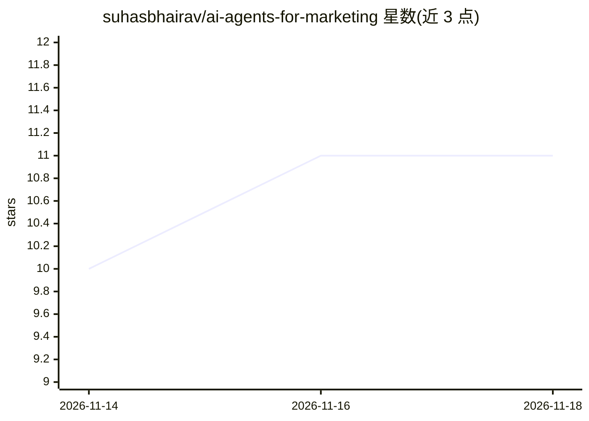

# suhasbhairav/ai-agents-for-marketing

⭐ 11 · JavaScript · MIT · 推送 2026-07-03 · [GitHub](https://github.com/suhasbhairav/ai-agents-for-marketing) · [官网](https://github.com/suhasbhairav/ai-agents-for-marketing) · 个人维护

**面向 HubSpot 营销团队的 AI agent 工作台**

基于 Next.js 的营销操作系统，同步 HubSpot CRM 数据后以确定性分析优先计算商机，再由 OpenAI Agents SDK 编排的 11 个专家 agent（商机、受众、营销策略、邮件/SMS 文案、品牌审查、合规、分析等）进行解释与起草。强制人工审批流程，受众构建强制排除退订与抑制名单，含提示注入防护；默认提供合成数据的 Demo 模式，无需 HubSpot 凭据即可评估。

## 筛选速览

| 维度 | 判定 | 备注 |
|---|---|---|
| AI 角色 | `ai-native` | 本体是模型或模型工具 |
| 许可风险 | `permissive` | MIT |
| 部署形态 | `library` | 以包/库形式分发 |
| 模型依赖 | — | README 未给出锁定关系 |
| 硬件要求 | — | 无带数字的原话,不猜 |
| 安装摩擦 | `low` | 无编译、无系统依赖或容器化 |
| 成熟度 | — | 结构信号不足 |

## 能力要点

- 11 个专家 agent 编排，含可见执行轨迹与工具调用日志
- 确定性优先：SQL/JS 计算指标，AI 仅解释与操作化结果
- 审批优先：AI 不得自主发送/发布/修改 CRM 记录
- 强制排除退订、抑制名单等合规受众规则

## 适用场景

- 发现 CRM 中未转化的潜客与停滞商机
- 按生命周期与合规约束构建营销受众
- 起草并走审批流程产出营销活动
- 无 HubSpot 环境时用合成数据评估产品

## 场景标签

`AI 写作` `多智能体` · 领域:Agent 开发

## 证据(README 行号)

> L3: > Agentic marketing workspace for HubSpot CRM: discover revenue opportunities, build governed audiences, generate ca
> L101: - OpenAI Agents SDK execution when `OPENAI_API_KEY` is configured

## 星数曲线

2026-11-14 10 → 2026-11-18 11（+1）

---
*卡片 v1 · prompt 1.4 · 生成 2026-11-18 · 置信度 high · 依据 README sha `4017a50369d1` · [字段定义](../../DATASET.md)*
