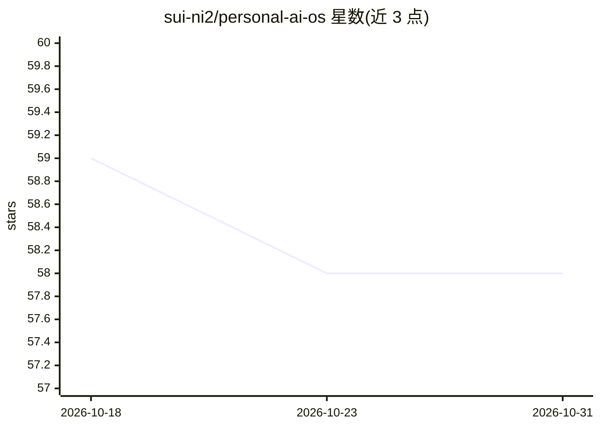

# sui-ni2/personal-ai-os

⭐ 58 · Python · Apache-2.0 · 推送 2026-10-26 · [GitHub](https://github.com/sui-ni2/personal-ai-os) · 个人维护 · 中文 README

**本地优先的个人 AI 工作台：聊天、记忆、可审计工具与项目插件**

面向个人长期 AI 工作的自托管工作台：Next.js 前端（聊天、记忆、仓库、项目视图）+ FastAPI 后端，SQLite 持久化。支持 OpenAI、Anthropic 远程适配器和可选的本地 Ollama 适配器，统一流式接口；包含允许清单 MCP 网关、SSE 执行协议、重启安全的会话历史与隔离的项目插件（含 P5 每日流程）。密钥仅存于服务端环境变量，审计负载递归脱敏；无任何 provider 配置时应用可安全启动。通过 Docker Compose 或 Windows 脚本本地运行，提供移动 PWA 安装。当前为社区版 v0.3.0，云账户与计费功能未上线。

## 筛选速览

| 维度 | 判定 | 备注 |
|---|---|---|
| AI 角色 | `ai-native` | 本体是模型或模型工具 |
| 许可风险 | `permissive` | Apache-2.0 |
| 部署形态 | `desktop` | 安装包/桌面程序 |
| 模型依赖 | local-ok | 支持本地模型 |
| 硬件要求 | — | 无带数字的原话,不猜 |
| 安装摩擦 | `low` | 无编译、无系统依赖或容器化 |
| 成熟度 | `idea` | |

## 能力要点

- OpenAI/Anthropic/可选本地 Ollama 适配器统一在单一流式接口后
- 允许清单 MCP 网关（HTTP 与固定命令 stdio 连接器）
- 重启安全的会话历史、执行轨迹恢复与审计负载脱敏
- 本地 Docker Compose 运行，无 API key 也可启动并验证隐私边界

## 适用场景

- 在本地自托管一个跨 provider 的个人 AI 聊天与记忆工作台
- 通过 MCP 网关以受控方式接入外部工具
- 管理项目级的 AI 工作上下文并在重启后保持连续性
- 在手机上以 PWA 形式访问已部署的个人 AI 实例

## 场景标签

`聊天机器人` `AI 助手` `Agent 记忆` · 领域:Agent 开发

## 证据(README 行号)

> L8: **Personal AI OS is a local-first, provider-neutral workspace for long-running AI work.**
> L61: - Next.js App Shell with Chat, Memory, Repository, Projects, and Settings views.
> L64: - Focused Text and GPT Live conversation modes. Completed Live transcripts stay in the
> L82: OpenAI and Anthropic calls require server-side credentials. Ollama uses a local service and is disabled by default 

## 星数曲线

2026-10-18 59 → 2026-10-31 58（-1）

---
*卡片 v1 · prompt 1.4 · 生成 2026-10-24 · 置信度 mid · 依据 README sha `bae30c6890ec` · [字段定义](../../DATASET.md)*
