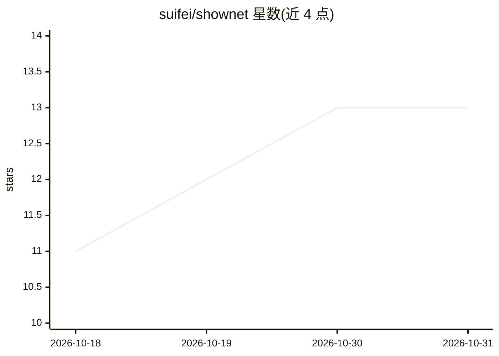

# suifei/shownet

⭐ 13 · Rust · GPL-3.0 · 推送 2026-08-25 · [GitHub](https://github.com/suifei/shownet) · 个人维护 · 中文 README

**带 AI 分析的本地抓包与协议逆向桌面工作台**

基于 Tauri 的桌面流量抓包工具（v0.4.37，macOS/Windows 发布包）：内嵌 Chrome 抓包、MITM 解密 HTTPS、与 Chrome 对齐的出站 TLS（JA4 比对）、JA3 指纹、每安装独立 Root CA、手机扫码装证。AI 部分：Agent 只读当前会话生成证据报告（报告链回请求序号），从已证实请求导出算法重放包与 Python/JS/Go/cURL 调用代码，未证实部分写入 GAPS.md。分析需配置 OpenAI 兼容端点（推荐第三方 ClaudeGPT，亦可接本地 Ollama/LM Studio）。限制：未商业代码签名，不做位级 JA3 克隆声明，证书锁定 App 只采元数据。

## 筛选速览

| 维度 | 判定 | 备注 |
|---|---|---|
| AI 角色 | `ai-enhanced` | 去掉 AI 部分产品仍成立 |
| 许可风险 | `viral` | GPL-3.0 |
| 部署形态 | `desktop` | 安装包/桌面程序 |
| 模型依赖 | local-ok | 支持本地模型 |
| 硬件要求 | — | 无带数字的原话,不猜 |
| 安装摩擦 | `low` | 无编译、无系统依赖或容器化 |
| 成熟度 | — | 结构信号不足 |

## 能力要点

- 内嵌 Chrome + MITM + 与 Chrome 对齐出站握手的单会话抓包链路
- AI 分析只读当前会话，报告须链回请求序号，未证实步骤写入 GAPS.md
- 从已证实请求生成算法重放包与 Python/JS/Go/cURL 代码
- 每份安装独立 Root CA，私钥加密本地存储，Android 免 Root 推证书

## 适用场景

- 逆向带签名的网站/App 接口，分析为何重放 403
- 解密手机 App 的 HTTPS 流量并整理成可调用客户端代码
- 排查代理下 TLS 指纹/Cookie 拆碎导致的登录失败

## 场景标签

`网络安全` · 领域:学习与行业

## 证据(README 行号)

> L102: ### 3. 用 AI 把会话说清楚
> L118: 分析报告可导出算法重放包；流量或集合可进 Request Lab 生成代码。没证实的步骤会标出来。

## 星数曲线

2026-10-18 11 → 2026-10-31 13（+2）

---
*卡片 v1 · prompt 1.4 · 生成 2026-10-31 · 置信度 mid · 依据 README sha `775c33c29fd7` · [字段定义](../../DATASET.md)*
