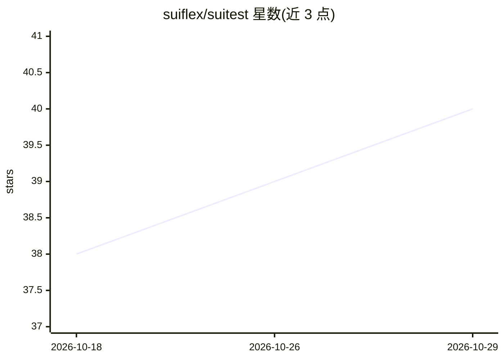

# suiflex/suitest

⭐ 40 · Python · Apache-2.0 · 推送 2026-10-28 · [GitHub](https://github.com/suiflex/suitest) · [官网](https://suitest.suiflex.dev/) · 组织维护

**自托管测试平台：用例管理+MCP 自动执行+可选 AI 分析**

免费自托管（Apache-2.0）的软件测试平台：Web 面板管理测试用例与套件，通过 MCP 插件自动执行浏览器（Playwright）、API、数据库、移动端、桌面端等目标的测试，采集截图/视频证据并自动记录缺陷，提供通过率与追踪报表。AI 为可选功能：在工作区配置 LLM（Ollama/llama.cpp/vLLM/Anthropic/OpenAI 等，含 100+ hosted API）后启用 MCP 执行、测试生成与自动诊断；不接 LLM 也可手动管理用例。安装支持 npx 一键引导、Docker Compose、Helm 三种方式。

## 筛选速览

| 维度 | 判定 | 备注 |
|---|---|---|
| AI 角色 | `ai-enhanced` | 去掉 AI 部分产品仍成立 |
| 许可风险 | `permissive` | Apache-2.0 |
| 部署形态 | `self-host` | docker 或自建部署 |
| 模型依赖 | local-ok | 支持本地模型 |
| 硬件要求 | — | 无带数字的原话,不猜 |
| 安装摩擦 | `low` | 无编译、无系统依赖或容器化 |
| 成熟度 | — | 结构信号不足 |

## 能力要点

- 手动测试用例管理（TCM），无需 LLM 即可使用
- MCP 插件执行浏览器/API/数据库/移动/桌面等多目标测试
- 证据采集（截图/视频）与缺陷自动记录、需求↔测试↔缺陷追踪
- BYO LLM：支持自托管（Ollama/llama.cpp/vLLM/LM Studio）与 100+ hosted API

## 适用场景

- 团队自托管管理测试用例并自动执行回归测试
- 在 CI/CD 中通过 Webhook 集成测试运行与报告
- 用自有 LLM 从 PRD 生成测试并自动诊断失败原因
- 通过 MCP server 在 Claude Code/Cursor 等 IDE 中生成与运行测试

## 场景标签

`浏览器自动化` `代码生成` · 领域:效率与自动化

## 证据(README 行号)

> L28: **Here's what that means:** You have a website or app. You want to make sure all its features work correctly — butt
> L287: **For manual TCM, no.** MCP execution, test runs, and AI features require a validated workspace LLM.

## 星数曲线

2026-10-18 38 → 2026-10-29 40（+2）

---
*卡片 v1 · prompt 1.4 · 生成 2026-10-25 · 置信度 mid · 依据 README sha `e97361c86eec` · [字段定义](../../DATASET.md)*
