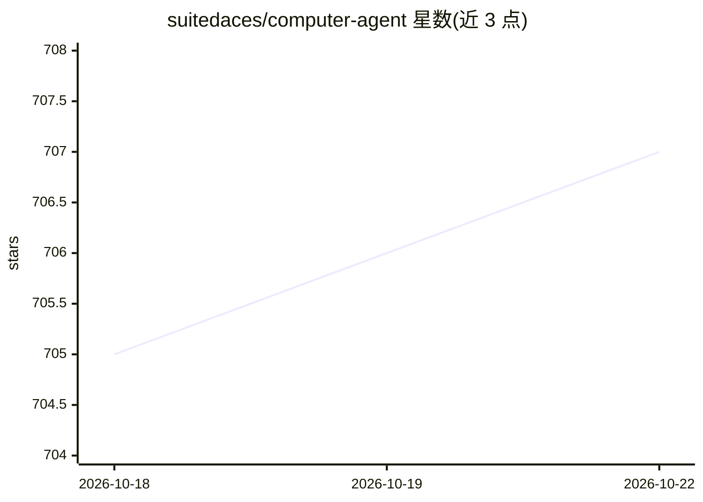

# suitedaces/computer-agent

⭐ 706 · Rust · NOASSERTION · 推送 2026-08-13 · [GitHub](https://github.com/suitedaces/computer-agent) · 个人维护

**本地桌面 AI agent：用自然语言指令控制终端、浏览器与键鼠**

基于 Tauri、React 与 Rust 构建的桌面应用，接受自然语言指令后由 AI agent 执行计算机操作。提供两种模式：Computer Use Mode 通过截图感知屏幕并直接控制鼠标键盘，适用于跨应用任务；Background Mode 基于 Chrome DevTools Protocol 做网页自动化并用终端执行其余任务，不占用键鼠。需 Rust/Cargo、Node.js 与 Anthropic API key，从源码运行；macOS 需授予辅助功能权限。模型可选 Haiku/Sonnet/Opus。

## 筛选速览

| 维度 | 判定 | 备注 |
|---|---|---|
| AI 角色 | `ai-native` | 本体是模型或模型工具 |
| 许可风险 | `none` | NOASSERTION |
| 部署形态 | `library` | 以包/库形式分发 |
| 模型依赖 | — | README 未给出锁定关系 |
| 硬件要求 | — | 无带数字的原话,不猜 |
| 安装摩擦 | `low` | 无编译、无系统依赖或容器化 |
| 成熟度 | — | 结构信号不足 |

## 能力要点

- Computer Use 模式：截图感知 + 直接控制鼠标键盘
- Background 模式：Chrome DevTools Protocol 网页自动化 + 终端执行
- 前端 React/TypeScript、后端 Rust/Tauri 2 + Tokio
- UI 内可选 Haiku/Sonnet/Opus 模型

## 适用场景

- 让 AI 代为操作跨多个桌面应用的任务
- 网页与终端任务的异步自动化执行
- 用快捷键唤起 push-to-talk 指令并监控 agent 运行

## 场景标签

 · 领域:桌面自动化/LLM 应用

## 证据(README 行号)

> L4: Local AI agent that controls your computer. Give it natural language instructions and watch it take screenshots, mov
> L19: **Computer Use Mode** - Takes over your screen. Sees what you see via screenshots and controls your cursor and keyb
> L28: - Anthropic API key

## 星数曲线

2026-10-18 705 → 2026-10-22 707（+2）

---
*卡片 v1 · prompt 1.4 · 生成 2026-10-21 · 置信度 high · 依据 README sha `4df20469fc70` · [字段定义](../../DATASET.md)*
