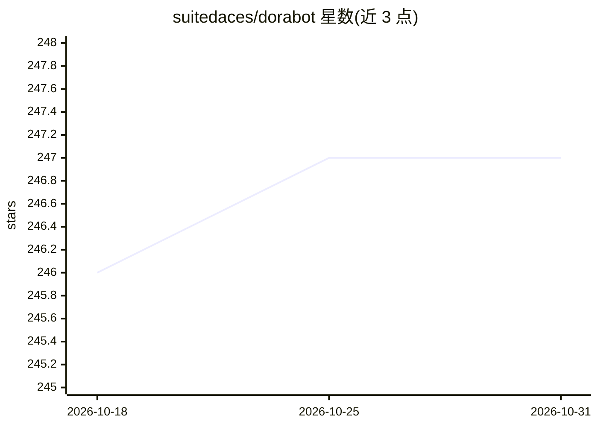

# suitedaces/dorabot

⭐ 247 · TypeScript · MIT · 推送 2026-10-26 · [GitHub](https://github.com/suitedaces/dorabot) · [官网](https://dora.so) · 组织维护

**macOS 常驻自主 AI agent 桌面应用，带 IDE 工作区与多渠道消息**

运行在 macOS 上的 Electron 桌面应用：内置 IDE 式工作区（文件浏览、Monaco 编辑器、Git 面板、PTY 终端），agent 可自主设定目标、执行计划、运行定时任务、进行浏览器自动化，并通过 WhatsApp/Telegram 与用户交互。提供跨会话持久记忆（SOUL.md/USER.md/MEMORY.md）、内置技能与 MCP 服务器接入（Smithery）。模型依赖用户自有的 Claude Code / OpenAI Codex 订阅或 API key，本体不附带模型。数据本地运行，无云端中转。

## 筛选速览

| 维度 | 判定 | 备注 |
|---|---|---|
| AI 角色 | `ai-native` | 本体是模型或模型工具 |
| 许可风险 | `permissive` | MIT |
| 部署形态 | `library` | 以包/库形式分发 |
| 模型依赖 | — | README 未给出锁定关系 |
| 硬件要求 | — | 无带数字的原话,不猜 |
| 安装摩擦 | `low` | 无编译、无系统依赖或容器化 |
| 成熟度 | — | 结构信号不足 |

## 能力要点

- agent 自主目标/计划/执行流水线，含研究与任务调度（cron、iCal RRULE、Apple Calendar 同步）
- 跨会话持久记忆与全文检索（SOUL/USER/MEMORY 配置文件）
- 浏览器自动化 40+ 操作，使用用户已登录的 Chrome profile
- 本地运行、token 认证网关、macOS 原生沙箱，依赖锁定精确版本

## 适用场景

- 让 AI agent 全天候自主处理研究与任务并主动发消息汇报
- 通过 Telegram/WhatsApp 与同一 agent 保持连续记忆的对话
- 在集成了 agent 的 IDE 工作区中管理和执行工作

## 场景标签

`AI 助手` `浏览器自动化` `编码 Agent` · 领域:效率与自动化

## 证据(README 行号)

> L3:  **A 24/7 self-learning AI agent with an integrated IDE workspace that runs itself.**
> L16: The agent manages its own goals, tracks research, messages you on Telegram and WhatsApp, runs scheduled tasks, and 
> L56: - **Multi-provider.** Claude, OpenAI Codex, MiniMax. Use the model you're already paying for.

## 星数曲线

2026-10-18 246 → 2026-10-31 247（+1）

---
*卡片 v1 · prompt 1.4 · 生成 2026-10-22 · 置信度 high · 依据 README sha `d04be60e2225` · [字段定义](../../DATASET.md)*
