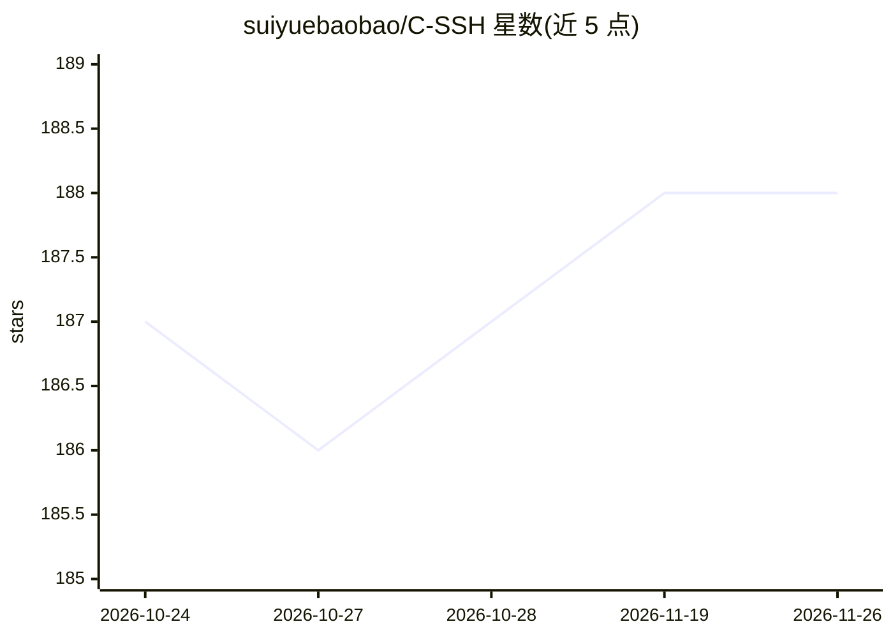

# suiyuebaobao/C-SSH

⭐ 188 · Rust · 推送 2026-11-13 · [GitHub](https://github.com/suiyuebaobao/C-SSH) · [官网](https://c-ssh.com) · 个人维护 · 中文 README

**面向运维与开发者的跨平台 SSH 客户端，集成 AI 助手**

将主机管理、终端、文件管理、监控与 AI 助手整合在同一客户端中，支持 Agent 与普通 SSH 连接，AI 可在全局、项目或单台主机粒度使用，并支持多个 AI 会话并行运行时的切换、进度显示与任务控制。提供 Windows/macOS/Linux/Android 预编译包，仅手动下载更新，不强制升级；桌面服务器浏览器依赖 Google Chrome，iOS 版暂停，Linux ARM64 与 deb 包仅在历史发布中。

## 筛选速览

| 维度 | 判定 | 备注 |
|---|---|---|
| AI 角色 | `ai-enhanced` | 去掉 AI 部分产品仍成立 |
| 许可风险 | `none` | — |
| 部署形态 | `desktop` | 安装包/桌面程序 |
| 模型依赖 | — | README 未给出锁定关系 |
| 硬件要求 | — | 无带数字的原话,不猜 |
| 安装摩擦 | `low` | 无编译、无系统依赖或容器化 |
| 成熟度 | `idea` | |

## 能力要点

- 主机、终端、文件与监控一体化管理，支持 Agent 与普通 SSH 连接
- AI 助手支持全局、项目、单台主机三种作用域与多会话并行
- Windows/macOS/Linux/Android 四平台预编译包，附 SHA256 校验
- 云端配置手动同步，也可不登录使用本机功能

## 适用场景

- 在一个客户端里管理多台服务器并做端口转发
- 在远程主机上同时运行多个 AI 任务并跟踪进度
- 跨桌面与手机同步主机配置

## 场景标签

`AI 助手` · 领域:对话与助手

## 证据(README 行号)

> L5: C-SSH 将主机管理、终端、文件、监控和 AI 助手放在同一个客户端中。本次补充 Linux x86_64 AppImage，按 Mac 0.9.9 的界面与使用方式对齐。
> L17: - 管理主机、终端、文件和监控，支持 Agent 与普通 SSH 连接。
> L18: - 在全局、项目或单台主机中使用 AI，查看任务进度和结果。

## 星数曲线

2026-10-24 187 → 2026-11-26 188（+1）

---
*卡片 v1 · prompt 1.4 · 生成 2026-11-26 · 置信度 high · 依据 README sha `804029733e67` · [字段定义](../../DATASET.md)*
