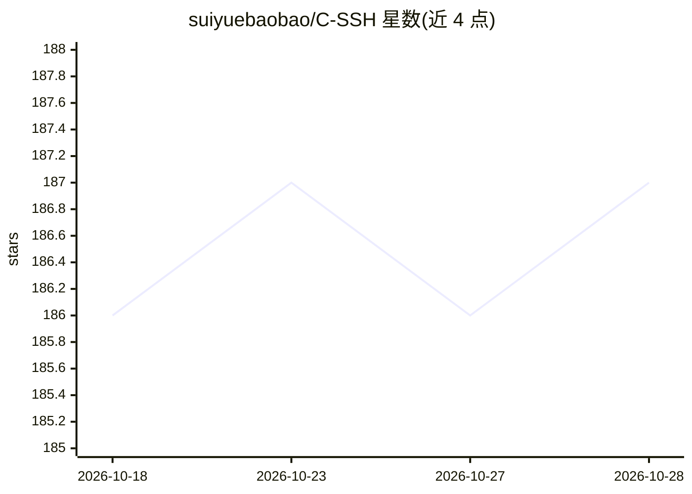

# suiyuebaobao/C-SSH

⭐ 187 · Rust · 推送 2026-10-28 · [GitHub](https://github.com/suiyuebaobao/C-SSH) · [官网](https://c-ssh.com) · 个人维护 · 中文 README

**面向 Windows/Mac/Android/Linux 的服务器运维客户端，含 AI 对话**

C-SSH 是一款跨平台服务器运维客户端（Rust 构建），覆盖 Windows、M 系列 Mac、Android 与 Linux，提供本地 SSH 与 Agent 功能且不要求 Cloud 登录；AI 对话、原始记录、Skills 与长期记忆保留在本机，不参与 Cloud 同步，所选模型上下文会发送给对应服务商。分发方式为手动下载安装包（十项正式包附 SHA256），不提醒升级、不强制更新；Mac 为 ad-hoc 签章未公证，iOS 不上传；客户端/共用核心/AI/Agent 源码不公开。

## 筛选速览

| 维度 | 判定 | 备注 |
|---|---|---|
| AI 角色 | `ai-enhanced` | 去掉 AI 部分产品仍成立 |
| 许可风险 | `none` | — |
| 部署形态 | `desktop` | 安装包/桌面程序 |
| 模型依赖 | — | README 未给出锁定关系 |
| 硬件要求 | — | 无带数字的原话,不猜 |
| 安装摩擦 | `low` | 无编译、无系统依赖或容器化 |
| 成熟度 | — | 结构信号不足 |

## 能力要点

- Windows/Mac/Android/Linux 四平台共十项正式安装包，附 SHA256 校验
- 本地 SSH／Agent 功能不要求 Cloud 登录
- AI 对话、Skills 与长期记忆保留本机，不参与 Cloud 同步
- Agent 兼容性复用机制：新增主机优先复用既有 Agent，缺失才安装

## 适用场景

- 在桌面或 Android 设备上通过 SSH/RDP 管理服务器
- 运维中使用内置 AI 对话辅助操作，数据保留本机
- 自托管云与服务器的一站式客户端管理

## 场景标签

`AI 助手` · 领域:对话与助手

## 证据(README 行号)

> L5: 面向Windows、M系列Mac、Android及Linux的伺服器運維客戶端。本地SSH／Agent功能不要求Cloud登入。
> L62: AI對話、原始紀錄、Skills與長期記憶保留在本機，不參與Cloud同步；所選模型上下文會發給對應服務商。公開倉保存說明、安裝包與既有Cloud白名單源码，客戶端／共用核心／AI／Agent源码不公開。

## 星数曲线

2026-10-18 186 → 2026-10-28 187（+1）

---
*卡片 v1 · prompt 1.4 · 生成 2026-10-22 · 置信度 mid · 依据 README sha `1c4689c0bd45` · [字段定义](../../DATASET.md)*
