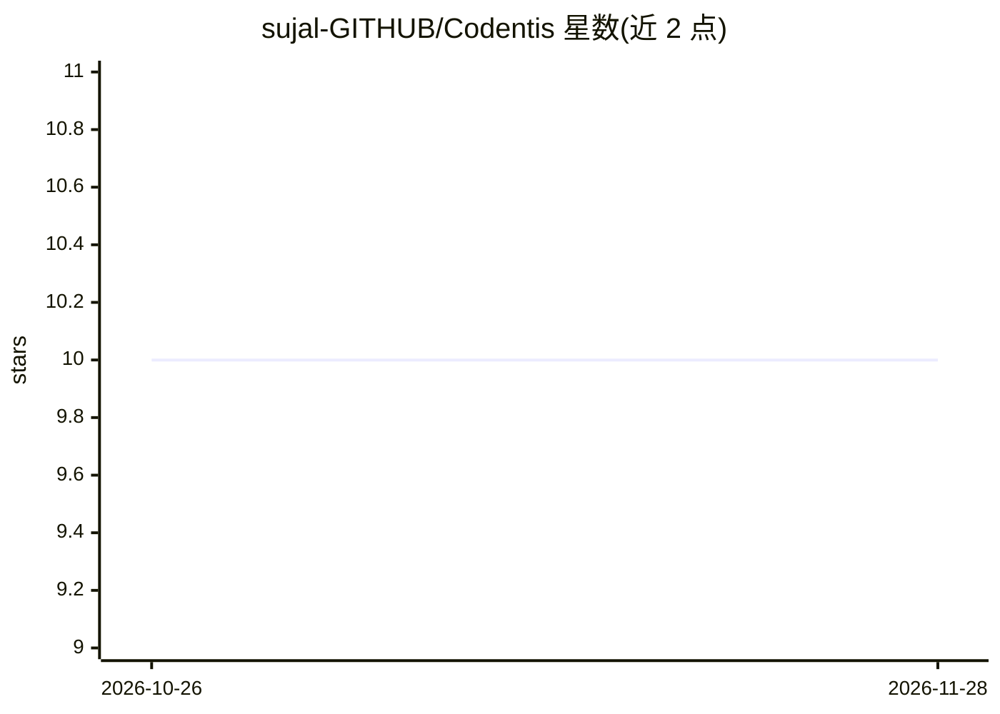

# sujal-GITHUB/Codentis

⭐ 10 · TypeScript · 推送 2026-06-25 · [GitHub](https://github.com/sujal-GITHUB/Codentis) · [官网](https://www.codentisai.space) · 个人维护

**终端 AI 编码 Agent：理解代码库并辅助开发**

面向终端开发者的 CLI AI Agent，通过模块化 agentic loop 提供代码辅助、文件操作与自动化工作流。机制上采用子 Agent 委派复杂分析/调试/重构任务，工具注册表带持久 ID 的可折叠输出，并有工作区信任系统（新目录操作需用户确认）。支持 OpenAI、Anthropic、OpenRouter 与本地 OpenAI 兼容端点，提供 EXE/PKG/DEB 独立安装包，也可从源码 pip 安装。

## 筛选速览

| 维度 | 判定 | 备注 |
|---|---|---|
| AI 角色 | `ai-native` | 本体是模型或模型工具 |
| 许可风险 | `none` | — |
| 部署形态 | `desktop` | 安装包/桌面程序 |
| 模型依赖 | locked-api |  |
| 硬件要求 | — | 无带数字的原话,不猜 |
| 安装摩擦 | `low` | 无编译、无系统依赖或容器化 |
| 成熟度 | — | 结构信号不足 |

## 能力要点

- 子 Agent 委派：将分析/调试/重构交给专门子 Agent
- Provider 无关：可切换 OpenAI/Anthropic/OpenRouter 及本地端点
- 工具输出持久 ID 与可折叠展示的 TUI
- 工作区信任系统需用户显式批准新目录操作

## 适用场景

- 快速熟悉陌生项目：构建知识图谱与依赖图
- 提交前用 reviewer agent 做安全/性能审计
- 框架或语言版本间的旧代码迁移
- 连接本地 LLM 做离线私密开发

## 场景标签

`编码 Agent` · 领域:编码与开发

## 证据(README 行号)

> L3: Codentis is a high-performance CLI AI agent designed for terminal-based developers. It provides intelligent code ass
> L10: - **Provider Agnostic**: Seamlessly switches between OpenAI, Anthropic, OpenRouter, and local OpenAI-compatible end

## 星数曲线

2026-10-26 10 → 2026-11-28 10（+0）

---
*卡片 v1 · prompt 1.4 · 生成 2026-11-19 · 置信度 high · 依据 README sha `0e39a799f538` · [字段定义](../../DATASET.md)*
