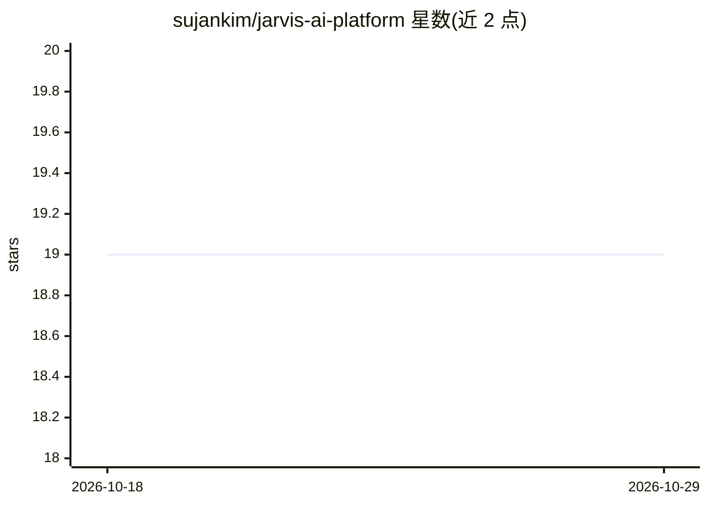

# sujankim/jarvis-ai-platform

⭐ 19 · Java · Apache-2.0 · 推送 2026-10-14 · [GitHub](https://github.com/sujankim/jarvis-ai-platform) · 个人维护

**本地优先的开源 AI 助手平台，数据不离开本机**

基于 Java 21、Spring Boot 4 与 Spring AI 2.0 构建的模块化本地 AI 编排平台，供个人在本机运行私有 AI 助手。功能包括流式 CLI 对话、JWT 认证、PostgreSQL 会话持久化、pgvector 长期记忆与 RAG 文档检索、DateTime/Calculator/Weather/WebSearch 工具、MCP Server、Whisper 语音转写与 TTS、ReACT 多步 Agent。主用 Ollama 本地模型（llama3.1:8b），Gemini 作为云端回退。通过 git clone + docker compose + Maven 启动；Web UI（Phase 7）仍在开发中。

## 筛选速览

| 维度 | 判定 | 备注 |
|---|---|---|
| AI 角色 | `ai-native` | 本体是模型或模型工具 |
| 许可风险 | `permissive` | Apache-2.0 |
| 部署形态 | `self-host` | docker 或自建部署 |
| 模型依赖 | local-ok | 支持本地模型 |
| 硬件要求 | — | 无带数字的原话,不猜 |
| 安装摩擦 | `low` | 无编译、无系统依赖或容器化 |
| 成熟度 | — | 结构信号不足 |

## 能力要点

- Ollama 本地模型为主，Gemini 云端回退，会话数据存储于本机
- pgvector 语义记忆搜索与 RAG 引擎（PDF 处理、分块、上下文注入）
- ReACT Agent 多步任务执行与 MCP Server
- Whisper 语音转写与跨平台 TTS 的语音对话

## 适用场景

- 在本机运行一个数据不出门的私人 AI 助手
- 对自己的 PDF 文档做问答与长期记忆对话
- 通过语音与本地 AI 助手交互

## 场景标签

`AI 助手` `文档问答` `语音 Agent` · 领域:对话与助手

## 证据(README 行号)

> L26: It is a **modular AI orchestration platform** that runs entirely on your own machine with complete privacy.
> L60: |Ollama local AI (primary)|✅|v0.1.0|

## 星数曲线

2026-10-18 19 → 2026-10-29 19（+0）

---
*卡片 v1 · prompt 1.4 · 生成 2026-10-28 · 置信度 high · 依据 README sha `f59377dafacd` · [字段定义](../../DATASET.md)*
