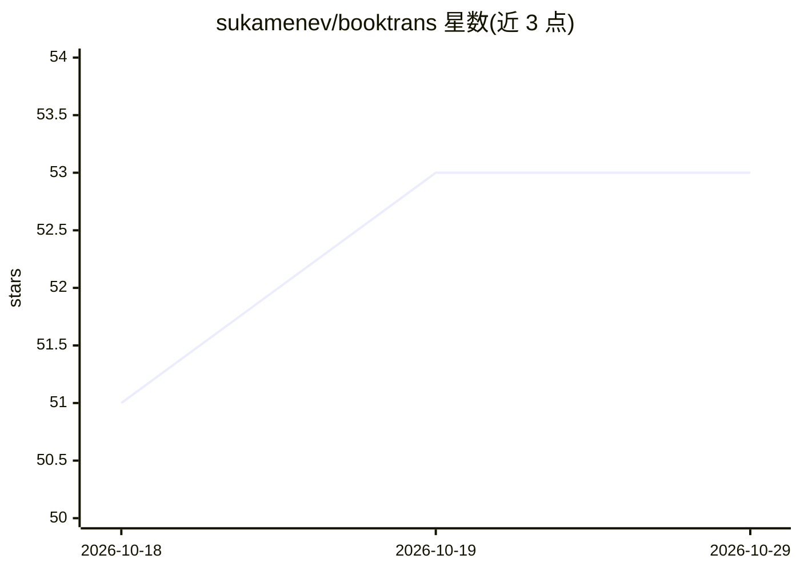

# sukamenev/booktrans

⭐ 53 · Python · MIT · 推送 2026-10-26 · [GitHub](https://github.com/sukamenev/booktrans) · 个人维护 · 中文 README

**整本书一键翻译管线：侦察、翻译、编辑、加注、出书**

命令行工具，输入 epub/fb2/html/pdf/md/txt，输出 fb2/epub/html/md/txt/LaTeX/pdf 成书。流程为：样式普查识别出版商标记、侦察叙述者与术语、分块翻译（共享术语表与滚动剧情摘要）、无原文编辑后对照校验、保留脚注/链接/图片并添加注释脚注。默认 agent 为 Claude Code，支持 Antigravity、Codex、API 与自定义 CLI；支持断点续跑、限流等待、截断回复拒绝与模型切换。系列书可复用既有译名（--like）。需 Python 3.9+ 与已配置的模型后端；拒绝 DRM 加密 EPUB。

## 筛选速览

| 维度 | 判定 | 备注 |
|---|---|---|
| AI 角色 | `ai-native` | 本体是模型或模型工具 |
| 许可风险 | `permissive` | MIT |
| 部署形态 | `library` | 以包/库形式分发 |
| 模型依赖 | locked-api |  |
| 硬件要求 | — | 无带数字的原话,不猜 |
| 安装摩擦 | `low` | 无编译、无系统依赖或容器化 |
| 成熟度 | — | 结构信号不足 |

## 能力要点

- 样式普查让模型判定标记角色，产出可手改的 structure.json
- 分块翻译共享术语与滚动剧情摘要，编辑后对照原文校验
- 断点续跑；已完成的翻译重建输出格式不发起模型调用
- 系列书沿用已接受的译名与人物卡（--like）

## 适用场景

- 把一本外文小说完整翻译成 epub/fb2 等电子书格式
- 翻译同一系列的多本书并保持人名术语一致
- 生成源文/译文对照的双语学习用书（--bilingual）

## 场景标签

`AI 写作` · 领域:内容生成

## 证据(README 行号)

> L5: **Translate a whole book in one run.** Takes epub, fb2, html, pdf, md or txt;
> L23: book-level workflow, whether you use Antigravity, Claude Code, Codex or an API.

## 星数曲线

2026-10-18 51 → 2026-10-29 53（+2）

---
*卡片 v1 · prompt 1.4 · 生成 2026-10-24 · 置信度 high · 依据 README sha `05c43df00970` · [字段定义](../../DATASET.md)*
