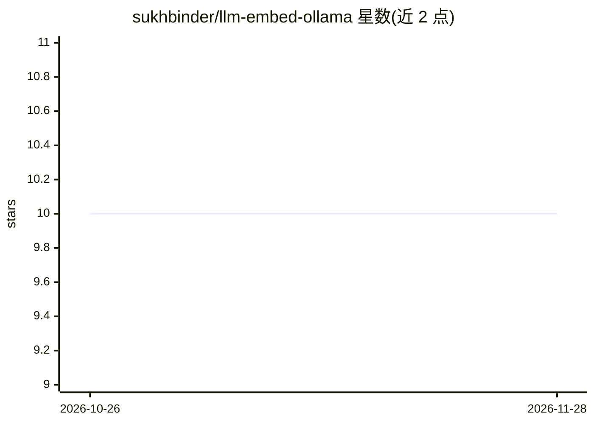

# sukhbinder/llm-embed-ollama

⭐ 10 · Python · Apache-2.0 · 推送 2026-01-20 · [GitHub](https://github.com/sukhbinder/llm-embed-ollama) · 个人维护

**LLM 插件：调用本地 Ollama 服务器的嵌入模型**

这是 Simon Willison 的 llm CLI 工具的插件，通过本地运行的 Ollama 服务器为 llm 提供嵌入模型接入。安装后为 llm embed / llm embed-multi / llm similar 命令注册 all-minilm、nomic-embed-text、mxbai-embed-large、bge-large、bge-m3 五个嵌入模型，并支持 llm 框架的前缀/后缀设置以区分 query 与 document 嵌入。使用前提是本机已有 Ollama 服务在运行，且模型需先 ollama pull 下载。面向已使用 llm 工具链、想在本地生成文本嵌入的开发者。

## 筛选速览

| 维度 | 判定 | 备注 |
|---|---|---|
| AI 角色 | `ai-ecosystem` | LLM/agent 周边工具 |
| 许可风险 | `permissive` | Apache-2.0 |
| 部署形态 | `library` | 以包/库形式分发 |
| 模型依赖 | local-ok | 支持本地模型 |
| 硬件要求 | — | 无带数字的原话,不猜 |
| 安装摩擦 | `low` | 无编译、无系统依赖或容器化 |
| 成熟度 | — | 结构信号不足 |

## 能力要点

- 为 llm CLI 注册 5 个 Ollama 嵌入模型（all-minilm、nomic-embed-text 等）
- 支持 llm embed / embed-multi / similar 嵌入与相似检索流程
- 支持可选的嵌入前缀/后缀（Python API 中 model.prefix 设置）

## 适用场景

- 在 llm 工具链中对文本生成向量化嵌入
- 对目录下批量文件（如大量 README）做嵌入并存储
- 用 llm similar 对已存嵌入做相似度检索

## 场景标签

`语义搜索` · 领域:知识与检索

## 证据(README 行号)

> L8: LLM plugin providing access to embedding models running on local Ollama server.
> L12: Install this plugin in the same environment as LLM.

## 星数曲线

2026-10-26 10 → 2026-11-28 10（+0）

---
*卡片 v1 · prompt 1.4 · 生成 2026-11-19 · 置信度 high · 依据 README sha `5ab1146efea6` · [字段定义](../../DATASET.md)*
