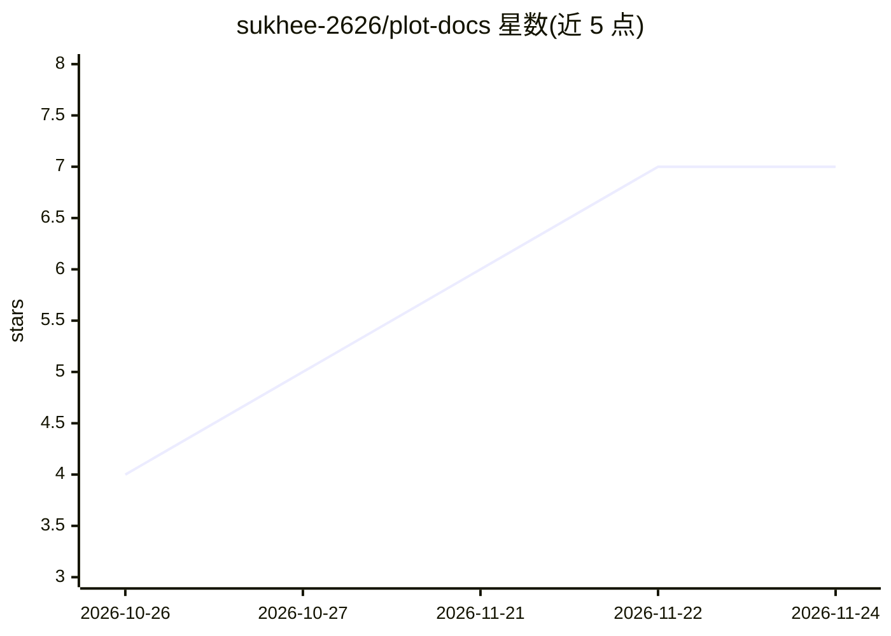

# sukhee-2626/plot-docs

⭐ 7 · TypeScript · Apache-2.0 · 推送 2026-11-18 · [GitHub](https://github.com/sukhee-2626/plot-docs) · [官网](https://plotxyz.ai) · 个人维护

**面向个人用户的本地优先桌面办公套件，含可选 AI 面板与数据分析**

基于 Electron 的桌面办公套件，可打开和保存 .docx/.xlsx/.pptx、PDF、Markdown 与 HTML，文档引擎在本地机器运行，无强制云账号。AI 部分为可选：面板可连接 Soopus AI 或自带 key 接入 OpenAI 兼容 provider（含本机模型）；AI Data Analytics 支持导入 CSV/JSON/XLSX、连接 SQLite/PostgreSQL/MySQL，本地确定性引擎执行剖析、SQL、透视与预测，无模型时回退本地自动化。数据限制 100 MB / 25 万行，SQL 只读，Python 仅限固定聚合。

## 筛选速览

| 维度 | 判定 | 备注 |
|---|---|---|
| AI 角色 | `ai-enhanced` | 去掉 AI 部分产品仍成立 |
| 许可风险 | `permissive` | Apache-2.0 |
| 部署形态 | `desktop` | 安装包/桌面程序 |
| 模型依赖 | — | README 未给出锁定关系 |
| 硬件要求 | — | 无带数字的原话,不猜 |
| 安装摩擦 | `low` | 无编译、无系统依赖或容器化 |
| 成熟度 | — | 结构信号不足 |

## 能力要点

- 本地编辑引擎支持 docx/xlsx/pptx/PDF/Markdown/HTML 互转与 PDF 导出
- 可选 AI 面板支持 OpenAI 兼容 provider 与本机模型，AI 修改带快照与回滚
- 确定性本地分析引擎无需 AI 模型即可运行全流程自动化
- SQL 只读限制与 SQLite authorizer 沙箱，Python 仅接受应用生成的固定聚合

## 适用场景

- 在没有云账号的环境里编辑 Office 文件并导出 PDF
- 把本地 CSV/Excel 数据导入后做剖析、透视与线性预测
- 定时在应用内运行数据集自动分析流水线
- 自带 API key 让 AI 辅助生成文档、幻灯片与数据图表

## 场景标签

`数据分析` `AI 助手` `AI 写作` · 领域:效率与自动化

## 证据(README 行号)

> L33: Plot Docs is a desktop office suite built by **Plot XYZ.Ai**. It opens and saves
> L95: The AI panel is optional. Connect **Soopus AI** or bring your own key for an

## 星数曲线

2026-10-26 4 → 2026-11-24 7（+3）

---
*卡片 v1 · prompt 1.4 · 生成 2026-11-21 · 置信度 mid · 依据 README sha `6554eb6fc30f` · [字段定义](../../DATASET.md)*
