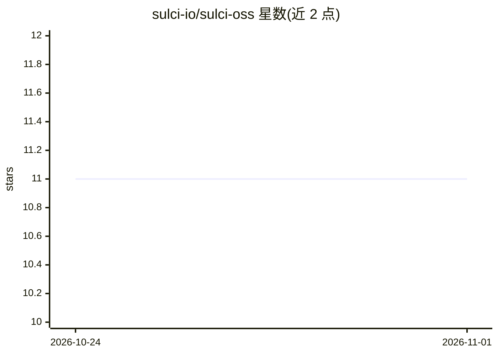

# sulci-io/sulci-oss

⭐ 11 · Python · NOASSERTION · 推送 2026-10-31 · [GitHub](https://github.com/sulci-io/sulci-oss) · [官网](https://sulci.io) · 组织维护

**面向 LLM 应用与 Agent 的语义缓存库，避免为相似问题重复调用模型**

Python 语义缓存库：按语义相似度（而非字符串精确匹配）命中已缓存的 LLM 回答，命中路径只需本地嵌入（内置 MiniLM embedder）而不再调用 LLM，以降低成本与延迟。提供上下文感知模式（将近期对话轮次融入查询向量）与 Agent 会话级缓存。后端支持 SQLite/ChromaDB/FAISS/Qdrant/Redis/Milvus 及 Sulci Cloud；另提供 MCP server、OpenAI/Anthropic 兼容的缓存代理与 LiteLLM 缓存层。限制：流式请求与工具调用响应不做缓存；代理命中不做鉴权；部分扩展需 Python 3.10+。

## 筛选速览

| 维度 | 判定 | 备注 |
|---|---|---|
| AI 角色 | `ai-ecosystem` | LLM/agent 周边工具 |
| 许可风险 | `none` | NOASSERTION |
| 部署形态 | `library` | 以包/库形式分发 |
| 模型依赖 | locked-api |  |
| 硬件要求 | — | 无带数字的原话,不猜 |
| 安装摩擦 | `low` | 无编译、无系统依赖或容器化 |
| 成熟度 | — | 结构信号不足 |

## 能力要点

- 按语义相似度命中缓存，内置 MiniLM 嵌入器，命中路径无需 LLM 调用
- 上下文感知模式：将近期对话轮次融入查询向量
- 7 种后端可选（SQLite/Chroma/FAISS/Qdrant/Redis/Milvus/Sulci Cloud）
- MCP server、OpenAI/Anthropic 兼容缓存代理、LiteLLM 缓存层、LangChain/LlamaIndex 适配器

## 适用场景

- LLM 应用中缓存语义相似的问题，减少重复计费与延迟
- Agent 会话内复用已回答内容，提升会话命中率
- 无法安装库的容器化 Agent（如 Claude Code、Copilot CLI）通过 MCP server 使用缓存
- 不改代码，将现有 OpenAI/Anthropic SDK 指向缓存代理

## 场景标签

 · 领域:LLM 基础设施/缓存

## 证据(README 行号)

> L13: Sulci Cache is a drop-in Python library that caches LLM responses by **semantic meaning**, not exact string match. 
> L17: |Without Sulci Cache|With Sulci Cache|
> L272: Sulci as the cache layer inside a LiteLLM deployment.

## 星数曲线

2026-10-24 11 → 2026-11-01 11（+0）

---
*卡片 v1 · prompt 1.4 · 生成 2026-11-01 · 置信度 high · 依据 README sha `9a492d518d7d` · [字段定义](../../DATASET.md)*
