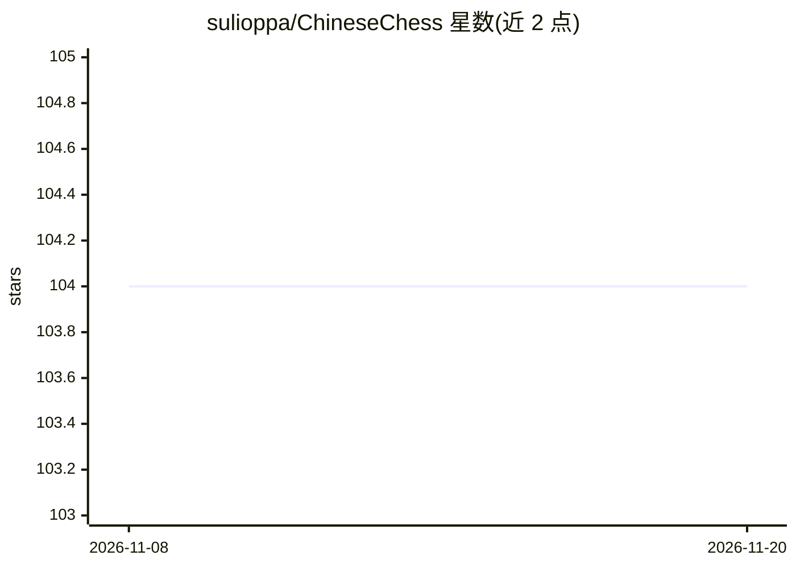

# sulioppa/ChineseChess

⭐ 104 · Swift · 推送 2026-10-12 · [GitHub](https://github.com/sulioppa/ChineseChess) · 个人维护 · 中文 README

**iOS 中国象棋 App，内置 PVS 搜索 AI 引擎**

iOS 平台的中国象棋应用（C & Obj-C & Swift），功能含人机对弈（可选 AI 等级）、摆设棋局、棋谱读取/保存/跳转、蓝牙与局域网联机对弈。AI 部分为传统搜索引擎：PVS（Alpha-Beta 改进）、Zobrist 哈希置换表、MVV 式着法排序、杀手着法与多种裁剪，支持棋谱库命中与扩充（含翻转局面共 4 种匹配）。README 自述置换表与重复局面裁剪带来输出不稳定，作者称技术为十多年前初级阶段，期望未来以深度学习（参照 AlphaZero）改进。

## 筛选速览

| 维度 | 判定 | 备注 |
|---|---|---|
| AI 角色 | `ai-enhanced` | 去掉 AI 部分产品仍成立 |
| 许可风险 | `none` | — |
| 部署形态 | `None` |  |
| 模型依赖 | — | README 未给出锁定关系 |
| 硬件要求 | — | 无带数字的原话,不猜 |
| 安装摩擦 | `low` | 无编译、无系统依赖或容器化 |
| 成熟度 | — | 结构信号不足 |

## 能力要点

- PVS 搜索结合置换表、杀手着法、重复局面裁剪等传统 AI 技术
- 棋谱库命中（含左右/红黑翻转共 4 局面）与批量扩充机制
- 人机对弈可选 AI 等级，支持蓝牙/局域网联机
- 开中局/残局区分子力估值与动态评估

## 适用场景

- 在 iPhone/iPad 上与内置 AI 下中国象棋
- 摆设棋局并载入棋谱研究
- 两人通过蓝牙或局域网对弈

## 场景标签

 · 领域:游戏/棋类

## 证据(README 行号)

> L24: - 支持人机对弈，可以选择AI等级。
> L82: - PVS. Alpha-Beta的改进算法，依赖于良序的着法顺序。

## 星数曲线

2026-11-08 104 → 2026-11-20 104（+0）

---
*卡片 v1 · prompt 1.4 · 生成 2026-11-18 · 置信度 high · 依据 README sha `7f6678bf4a71` · [字段定义](../../DATASET.md)*
