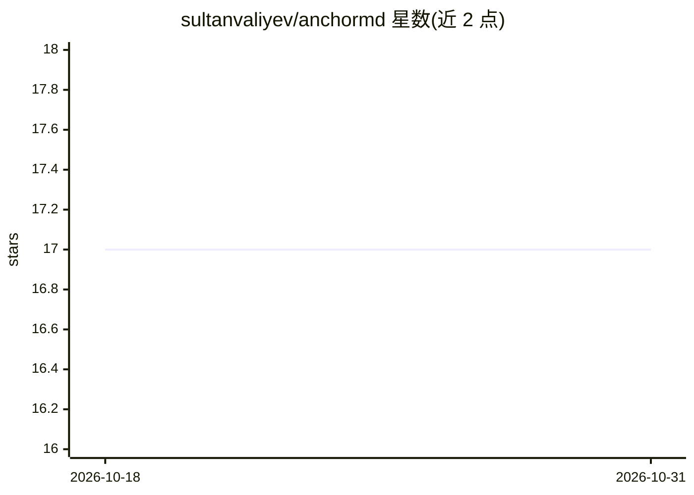

# sultanvaliyev/anchormd

⭐ 17 · TypeScript · MIT · 推送 2026-09-11 · [GitHub](https://github.com/sultanvaliyev/anchormd) · 个人维护

**面向 AI 编码代理的持久项目上下文管理 CLI**

基于 Bun 运行时的命令行工具，将项目计划以带 YAML frontmatter 的 markdown 文件形式存储在 .anchor/plans/ 目录，支持任意深度嵌套。计划间通过 wiki 风格链接形成强边/深链接，自动从内容中提取文件路径、模型、路由、脚本等实体，两个计划引用同一实体时生成弱边，构成可查看的关系图（文本/Mermaid/DOT）。搜索基于 QMD，提供 BM25 词法、向量语义（需 sqlite-vec）与混合三种模式，数据存于中央数据库 ~/.anchormd/anchormd.sqlite，按项目集合隔离。附带 skill/SKILL.md 供 Claude Code 会话中调用。

## 筛选速览

| 维度 | 判定 | 备注 |
|---|---|---|
| AI 角色 | `ai-ecosystem` | LLM/agent 周边工具 |
| 许可风险 | `permissive` | MIT |
| 部署形态 | `None` |  |
| 模型依赖 | — | README 未给出锁定关系 |
| 硬件要求 | — | 无带数字的原话,不猜 |
| 安装摩擦 | `low` | 无编译、无系统依赖或容器化 |
| 成熟度 | — | 结构信号不足 |

## 能力要点

- markdown 计划 + YAML frontmatter，任意深度嵌套目录
- 强链接/深链接 + 实体提取生成弱边的关系图
- QMD 三种搜索模式（BM25/语义/混合），结果带深链接
- 中央 SQLite 数据库按项目集合隔离管理搜索数据

## 适用场景

- 为 AI 编码代理维护跨会话的项目计划与上下文
- 通过关系图发现计划间的显式与隐式依赖
- 在 Claude Code 中按 skill 工作流检索并更新计划

## 场景标签

`Agent 记忆` · 领域:Agent 开发

## 证据(README 行号)

> L3: Persistent project context for AI coding agents using linked markdown plans with relationship tracking and hybrid se
> L160: ## Claude Code Integration

## 星数曲线

2026-10-18 17 → 2026-10-31 17（+0）

---
*卡片 v1 · prompt 1.4 · 生成 2026-10-29 · 置信度 high · 依据 README sha `8368fe2463db` · [字段定义](../../DATASET.md)*
