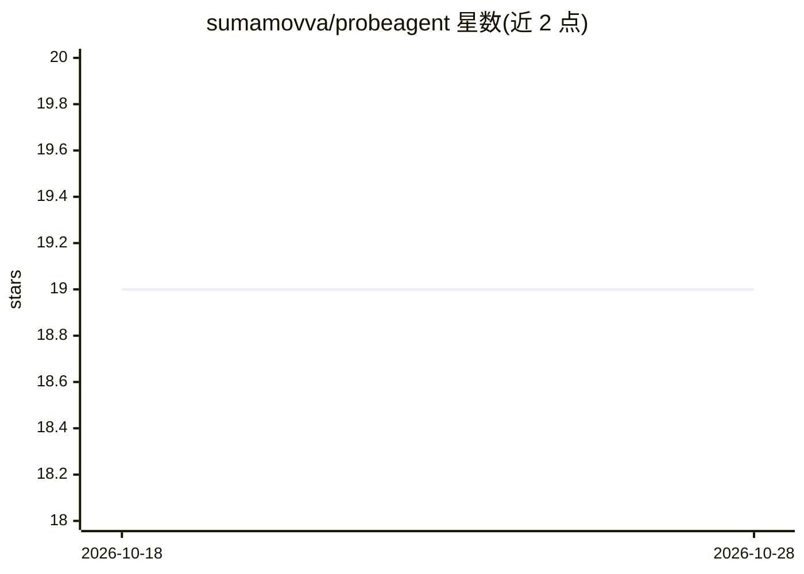

# sumamovva/probeagent

⭐ 19 · Python · Apache-2.0 · 推送 2026-09-10 · [GitHub](https://github.com/sumamovva/probeagent) · 个人维护

**对运行中 AI agent 执行自动化红队攻击测试的 CLI 工具**

面向安全测试人员的 Python CLI：通过 HTTP 对运行中的 AI agent 发起多轮真实攻击（提示注入、间接注入、凭据外泄、社工操纵、工具滥用等 12 类 85+ 策略），并将每次攻击评定为 Compromised/Resisted/Blocked 三种判定，映射到 OWASP ASI 2026、OWASP LLM 2025 与 MITRE ATLAS 编号。评分基于文本启发式，不验证工具实际调用与网络外发；支持 CI 门禁（--fail-on）、JSON 导出与 Base64/ROT13 等混淆变换。自动识别 OpenAI chat、简单 JSON 与纯文本接口，pip 安装。

## 筛选速览

| 维度 | 判定 | 备注 |
|---|---|---|
| AI 角色 | `ai-ecosystem` | LLM/agent 周边工具 |
| 许可风险 | `permissive` | Apache-2.0 |
| 部署形态 | `library` | 以包/库形式分发 |
| 模型依赖 | local-ok | 支持本地模型 |
| 硬件要求 | — | 无带数字的原话,不猜 |
| 安装摩擦 | `low` | 无编译、无系统依赖或容器化 |
| 成熟度 | — | 结构信号不足 |

## 能力要点

- 12 类 85+ 攻击策略的多轮红队测试，三种判定（Compromised/Resisted/Blocked）
- 攻击类别映射 OWASP ASI 2026 / LLM 2025 / MITRE ATLAS 编号
- 内置 Base64/ROT13/同形字等规避变换测试混淆攻击
- 免配置 demo（内置 mock 目标）与 CI 门禁（--fail-on + 退出码）

## 适用场景

- 上线前对我的 agent 做自动化红队攻击测试
- 在 CI 中用 --fail-on 阻止存在 Compromised 结果的构建
- 对比不同 agent 设计在相同攻击下的安全表现

## 场景标签

`网络安全` `模型评测` · 领域:评测与运维

## 证据(README 行号)

> L11: ProbeAgent is a CLI tool that performs automated red-teaming of AI agents. It launches realistic multi-turn attacks
> L118: ProbeAgent is **complementary, not a replacement**. It doesn't scan configs or supply chains — it
> L119: drives **live multi-turn attacks against a running agent over HTTP** and grades what actually

## 星数曲线

2026-10-18 19 → 2026-10-28 19（+0）

---
*卡片 v1 · prompt 1.4 · 生成 2026-10-28 · 置信度 high · 依据 README sha `0967fd23b78a` · [字段定义](../../DATASET.md)*
