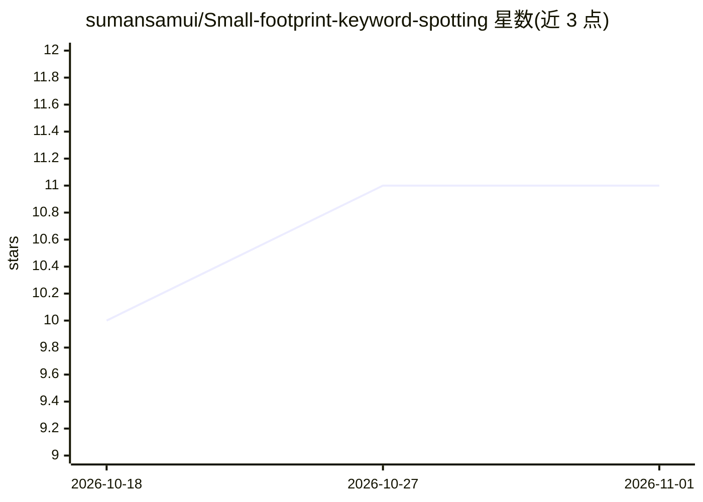

# sumansamui/Small-footprint-keyword-spotting

⭐ 11 · C++ · 推送 2026-05-26 · [GitHub](https://github.com/sumansamui/Small-footprint-keyword-spotting) · 组织维护

**TinyML 小足迹关键词检测综述论文的代码与补充材料库**

Neurocomputing (2026) 综述论文《Advances in Small-Footprint Keyword Spotting for TinyML》的配套仓库，提供实验代码、实现资源与补充材料。论文综述七大类高效 SF-KWS 技术：模型架构、学习技术、模型压缩、注意力架构、特征优化、神经架构搜索与混合方法，面向智能语音设备、手机与 IoT 边缘部署场景。仓库通过 git clone 克隆并 pip install 依赖运行，版权归作者所有。

## 筛选速览

| 维度 | 判定 | 备注 |
|---|---|---|
| AI 角色 | `ai-knowledge` | 知识聚合/清单类 |
| 许可风险 | `none` | — |
| 部署形态 | `library` | 以包/库形式分发 |
| 模型依赖 | — | README 未给出锁定关系 |
| 硬件要求 | — | 无带数字的原话,不猜 |
| 安装摩擦 | `low` | 无编译、无系统依赖或容器化 |
| 成熟度 | — | 结构信号不足 |

## 能力要点

- 配套已发表于 Neurocomputing (2026) 的综述论文（含 DOI）
- 覆盖七大类 SF-KWS 高效技术分类
- 提供实验代码与实现资源

## 适用场景

- 查找 TinyML 关键词检测的技术综述与文献线索
- 获取综述论文的实验代码与实现资源
- 了解边缘设备 KWS 的模型压缩与架构搜索方法

## 场景标签

`科研工具` · 领域:学习与行业

## 证据(README 行号)

> L3: This repository provides experimental codes, implementation resources, and supplementary materials related to the pa
> L16: Deploying SF-KWS systems on resource-constrained edge devices requires efficient Tiny Machine Learning (TinyML) fra

## 星数曲线

2026-10-18 10 → 2026-11-01 11（+1）

---
*卡片 v1 · prompt 1.4 · 生成 2026-11-01 · 置信度 high · 依据 README sha `97c653c274c4` · [字段定义](../../DATASET.md)*
