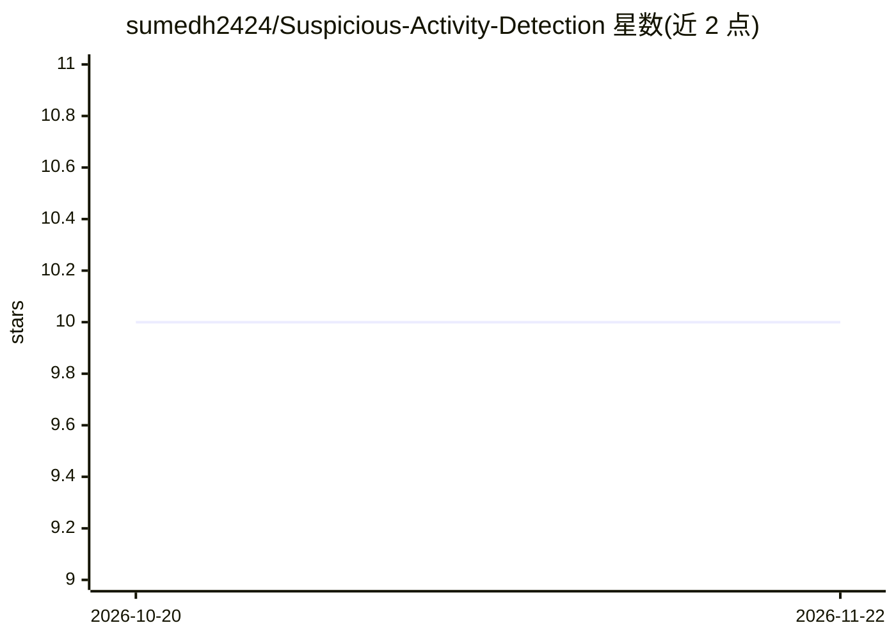

# sumedh2424/Suspicious-Activity-Detection

⭐ 10 · Python · MIT · 推送 2025-12-24 · [GitHub](https://github.com/sumedh2424/Suspicious-Activity-Detection) · [官网](https://github.com/sumedh2424/Suspicious-Activity-Detection?tab=readme-ov-file) · 个人维护

**实时识别监控视频中可疑人类行为的 CNN 检测系统**

面向 CCTV 监控画面的可疑人类活动识别项目：以 CNN 深度学习算法对视频中的人类活动进行常态/异常二分类，实时监控并自动生成告警。前端采用 Tkinter 构建、可自定义界面与参数，后端以 Python 实现。目标场景为车站、机场、银行、商场等公共与敏感区域的安防监测。README 未提供安装命令与依赖说明，仅描述启动应用、选择视频源等使用步骤。

## 筛选速览

| 维度 | 判定 | 备注 |
|---|---|---|
| AI 角色 | `ai-native` | 本体是模型或模型工具 |
| 许可风险 | `permissive` | MIT |
| 部署形态 | `None` |  |
| 模型依赖 | — | README 未给出锁定关系 |
| 硬件要求 | — | 无带数字的原话,不猜 |
| 安装摩擦 | `low` | 无编译、无系统依赖或容器化 |
| 成熟度 | — | 结构信号不足 |

## 能力要点

- CNN 模型对人类活动进行常态/异常分类
- 实时监控 CCTV 画面并自动生成可疑活动告警
- Tkinter 前端界面，支持自定义系统设置与参数

## 适用场景

- 对车站、机场、商场等公共场所的监控画面做实时异常活动检测
- 检测斗殴、盗窃、破坏等行为并触发告警
- 作为可疑活动识别方向的计算机视觉研究参考

## 场景标签

`网络安全` `目标检测` · 领域:学习与行业

## 证据(README 行号)

> L10: - **Activity Classification**: Utilizes machine learning algorithms to categorize human activities as usual and unu
> L14: - **Deep Learning Algorithm**: CNN (Convolutional Neural Network) is employed for accurate activity recognition and

## 星数曲线

2026-10-20 10 → 2026-11-22 10（+0）

---
*卡片 v1 · prompt 1.4 · 生成 2026-11-19 · 置信度 high · 依据 README sha `ae772e330f1e` · [字段定义](../../DATASET.md)*
