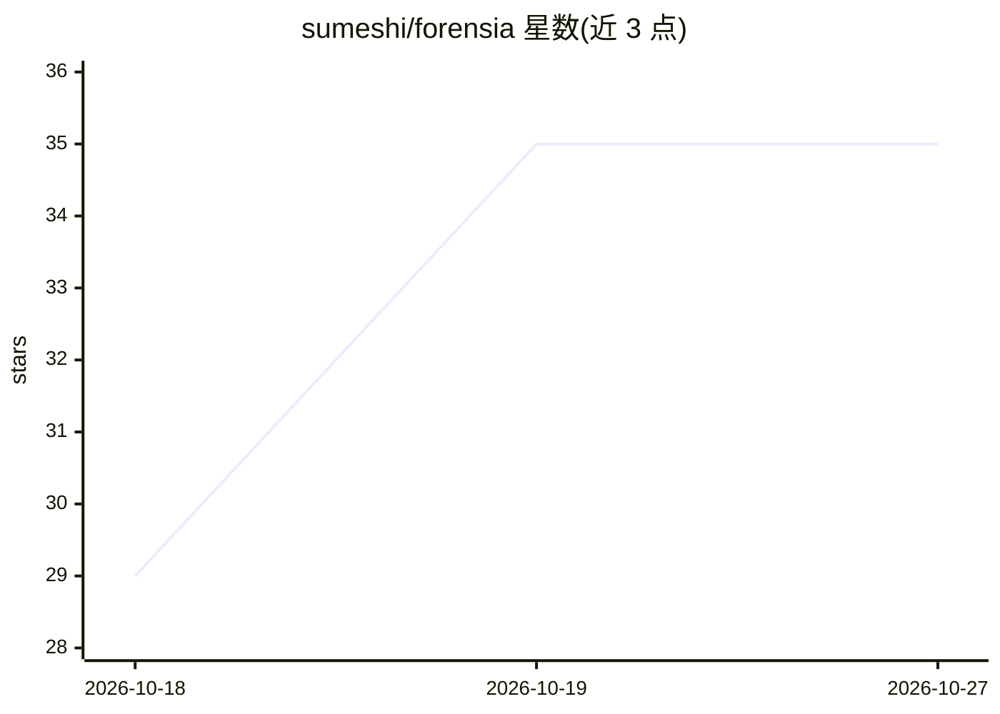

# sumeshi/forensia

⭐ 35 · Python · MIT · 推送 2026-10-18 · [GitHub](https://github.com/sumeshi/forensia) · [官网](https://pypi.org/project/forensia/) · 个人维护 · 中文 README

**给取证分析师：用本地 LLM 自主调查 Windows 取证痕迹的实验性框架**

面向个人与小规模 CSIRT 的 Windows 数字取证工具：读取 MFT、EVTX、Prefetch 与注册表数据，先以 Sigma 及自有规则提取线索，再由 LLM 循环执行『提出假设—检索验证证据—更新报告』的调查过程。设计面向 2B-30B 小模型，调查状态（证据、发现、假设、任务）与对话历史分离存储，由 harness 控制查询执行、验证条件与继续/终止判定。需 OpenAI 兼容的 LLM 后端，推荐本地部署以避免证据外发；项目自述为实验性，结果需人工复核。通过 git clone + uv 从源码运行。

## 筛选速览

| 维度 | 判定 | 备注 |
|---|---|---|
| AI 角色 | `ai-native` | 本体是模型或模型工具 |
| 许可风险 | `permissive` | MIT |
| 部署形态 | `None` |  |
| 模型依赖 | — | README 未给出锁定关系 |
| 硬件要求 | — | 无带数字的原话,不猜 |
| 安装摩擦 | `low` | 无编译、无系统依赖或容器化 |
| 成熟度 | `idea` | |

## 能力要点

- 读取 MFT/EVTX/Prefetch/注册表等 Windows 取证痕迹
- Sigma 规则（可离线本地化）提取调查线索作为起点
- 调查状态与 LLM 对话历史分离，支持长周期调查
- 面向 2B-30B 小模型的全隔离本地运行设计

## 适用场景

- 周末/假日应急响应中让 AI 持续梳理证据并验证假设
- 在隔离环境用本地 LLM 调查 Windows 主机取证痕迹
- 生成可回溯到证据的调查报告初稿供人工复核

## 场景标签

`网络安全` · 领域:学习与行业

## 证据(README 行号)

> L7: FORENSIA is an experimental harness for LLM-assisted Windows digital forensics.
> L9: It ingests artifacts such as MFT, EVTX, Prefetch, and Registry data, then uses findings from detection rules to begi
> L33: Individuals and small CSIRTs also have limited computing resources. Running frontier-scale models capable of handli

## 星数曲线

2026-10-18 29 → 2026-10-27 35（+6）

---
*卡片 v1 · prompt 1.4 · 生成 2026-10-25 · 置信度 high · 依据 README sha `598d78dd22f4` · [字段定义](../../DATASET.md)*
