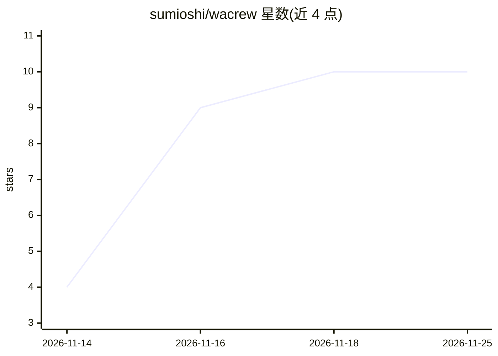

# sumioshi/wacrew

⭐ 10 · TypeScript · Apache-2.0 · 推送 2026-11-18 · [GitHub](https://github.com/sumioshi/wacrew) · [官网](https://wacrew.com.br) · 个人维护

**用你的语气自动回复 WhatsApp 客户消息的自托管 AI 客服**

基于 Baileys（WhatsApp Web 多设备协议）的自托管系统：把群组与私聊汇入按等待时间排序的队列，语音自动转录，AI 参考用户历史消息的风格起草回复，经确定性审查过滤机器人腔后以拟人节奏发送（已读回执、打字指示、气泡间停顿）。默认确认模式，每条回复需人工放行，也可按聊天开启自动模式。面板为 Next.js，附带 37 个工具的 MCP server 供编码代理操作数据。要求 Node 20+ 与 ffmpeg，本地转录需 Apple Silicon，否则走 OpenRouter API。

## 筛选速览

| 维度 | 判定 | 备注 |
|---|---|---|
| AI 角色 | `ai-native` | 本体是模型或模型工具 |
| 许可风险 | `permissive` | Apache-2.0 |
| 部署形态 | `self-host` | docker 或自建部署 |
| 模型依赖 | locked-api |  |
| 硬件要求 | — | 无带数字的原话,不猜 |
| 安装摩擦 | `low` | 无编译、无系统依赖或容器化 |
| 成熟度 | — | 结构信号不足 |

## 能力要点

- 按等待时间排序的统一收件箱，语音消息自动转录
- 基于用户本人消息测量的写作风格生成回复，带机器人腔审查（botsmell 库）
- 拟人化投递：已读回执、打字指示与停顿，客户再发言或人工回复即中断
- 37 个工具的 MCP server，支持 Claude Code、Codex、Gemini CLI 等客户端

## 适用场景

- 在 WhatsApp 上接单或交付的客户，避免消息被漏看
- 多条消息合并处理并排队，确保没有客户长时间等待
- 通过编码代理（MCP）批量查询、归类和回复聊天记录

## 场景标签

`聊天机器人` `语音识别` · 领域:对话与助手

## 证据(README 行号)

> L5:  An AI that answers your WhatsApp in your own voice, so clients talk to you, not to a bot.
> L53: **Writes like you, delivers like a person.** The AI reads the history and writes with your punctuation, openings an
> L78: - **MCP server** (`web/mcp/server.ts`): 37 tools over the same data, for Claude Code, Codex, Antigravity, Gemini CL

## 星数曲线

2026-11-14 4 → 2026-11-25 10（+6）

---
*卡片 v1 · prompt 1.4 · 生成 2026-11-19 · 置信度 high · 依据 README sha `e294bc5c52c6` · [字段定义](../../DATASET.md)*
