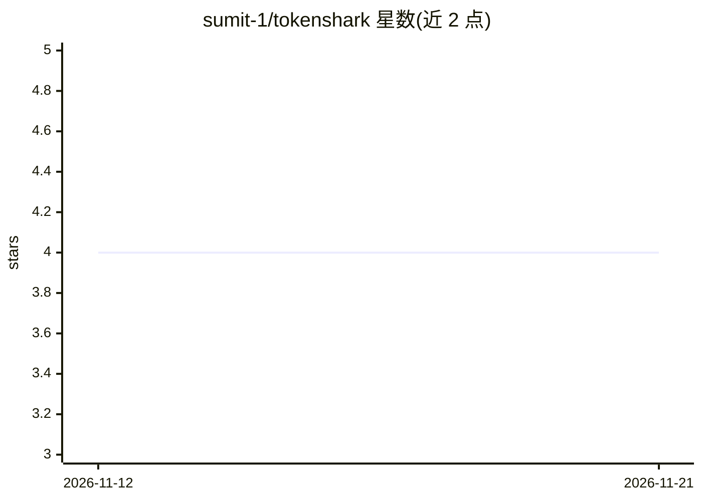

# sumit-1/tokenshark

⭐ 4 · Python · GPL-3.0 · 推送 2026-11-17 · [GitHub](https://github.com/sumit-1/tokenshark) · 个人维护

**面向研究人员与学习者在浏览器中检查、编辑和单步调试开源语言与图像模型**

Tokenshark 是一个在浏览器中运行的可视化调试环境，从纯 PyTorch 实现读取开源权重模型（无 transformers/diffusers 运行时依赖），支持逐块、逐 token 单步执行、流程图编辑、激活干预（patch/steer/clamp）、logit lens 与 word cloud 解码、MoE 专家路由控制、KV cache 编辑、多轮对话及运行导出为独立 Python 脚本。模型家族以插件形式声明，含 LLM、Stable Diffusion 与 DiT 图像模型。面向研究者、教育者与可解释性学习者，训练模块限于课堂规模的极小模型。

## 筛选速览

| 维度 | 判定 | 备注 |
|---|---|---|
| AI 角色 | `ai-native` | 本体是模型或模型工具 |
| 许可风险 | `viral` | GPL-3.0 |
| 部署形态 | `library` | 以包/库形式分发 |
| 模型依赖 | locked-api |  |
| 硬件要求 | — | 无带数字的原话,不猜 |
| 安装摩擦 | `medium` | 含编译或系统依赖之一 |
| 成熟度 | — | 结构信号不足 |

## 能力要点

- 浏览器内逐块/逐 token 单步调试，可 fork 生成路径（top-10 候选强制分支）
- 激活 patching、神经元钳制、steering vectors、MoE 专家 ban/force/自定义路由
- 任意运行可导出为 tokenshark.api 独立 Python 脚本
- 内置复现 Anthropic introspection 类实验的 Introspection 面板

## 适用场景

- 在课堂上可视化讲解 transformer 块与 token 生成过程
- 对开源模型做因果追踪与神经元定位等机制可解释性实验
- 研究 MoE 路由行为并对专家进行 knock-out sweep
- 编辑 KV cache 与 per-layer prompt 观察对生成的影响

## 场景标签

`图像生成` `教程课程` `模型评测` · 领域:评测与运维

## 证据(README 行号)

> L3: Open, inspect, edit, and train how open-weight language and image models compute in the browser, from pure Python.
> L38: - **Flow editor.** Each model is drawn as boxes and arrows (`prompt → tokenizer → embed → blocks → norm → head → sa
> L40: - **Raw PyTorch engine.** No `transformers`, no `diffusers` at runtime. Every matmul is in `tokenshark/llm.py`, `to

## 星数曲线

2026-11-12 4 → 2026-11-21 4（+0）

---
*卡片 v1 · prompt 1.4 · 生成 2026-11-21 · 置信度 high · 依据 README sha `3ef4fd77d6da` · [字段定义](../../DATASET.md)*
