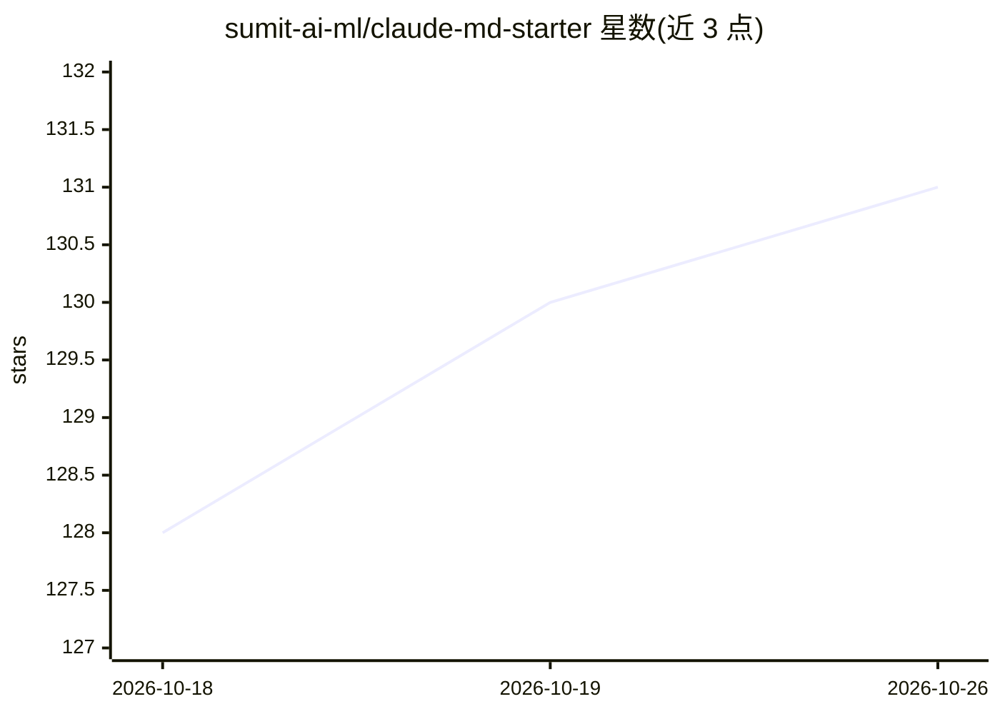

# sumit-ai-ml/claude-md-starter

⭐ 131 · MIT · 推送 2026-06-16 · [GitHub](https://github.com/sumit-ai-ml/claude-md-starter) · 个人维护

**给 Claude Code 用的 CLAUDE.md 行为规则模板，含验证与自治规则**

一个单文件配置仓库：提供分层组织的 CLAUDE.md，让 Claude Code 先规划再编码、保持小步修改、按可验证的完成定义工作，并规定仅在任务可程序化检查时才进入自治循环。第 1-4 层规则来自 andrej-karpathy-skills 的四原则，斜杠命令来自 gstack，验证 Harness 与循环/自治章节为本仓库原创。无构建步骤与运行时依赖，使用方式是复制文件到项目根目录并编辑 Project 与 Harness 两节。

## 筛选速览

| 维度 | 判定 | 备注 |
|---|---|---|
| AI 角色 | `ai-ecosystem` | LLM/agent 周边工具 |
| 许可风险 | `permissive` | MIT |
| 部署形态 | `None` |  |
| 模型依赖 | — | README 未给出锁定关系 |
| 硬件要求 | — | 无带数字的原话,不猜 |
| 安装摩擦 | `low` | 无编译、无系统依赖或容器化 |
| 成熟度 | — | 结构信号不足 |

## 能力要点

- 分层 CLAUDE.md：Karpathy 四原则 + gstack 工作流命令 + 原创验证与自治规则
- Harness 章节由用户填入定义完成的测试/lint/构建命令
- 自治命令 /goal、/loop、/batch 仅用于可程序化验证的任务
- 无构建步骤、无运行时依赖

## 适用场景

- 为我的项目快速套用一套 Claude Code 行为规范
- 让 Claude Code 的改动都经过我定义的测试与 lint 验证
- 把机械可验证的批量修改交给自治循环执行

## 场景标签

`提示工程` · 领域:Agent 开发

## 证据(README 行号)

> L5: This repo is not an application. It is a single file worth copying: **`CLAUDE.md`**, a layered set of behavioral rul
> L26: - Claude Code, Anthropic's CLI coding agent

## 星数曲线

2026-10-18 128 → 2026-10-26 131（+3）

---
*卡片 v1 · prompt 1.4 · 生成 2026-10-23 · 置信度 high · 依据 README sha `92c1274aee99` · [字段定义](../../DATASET.md)*
