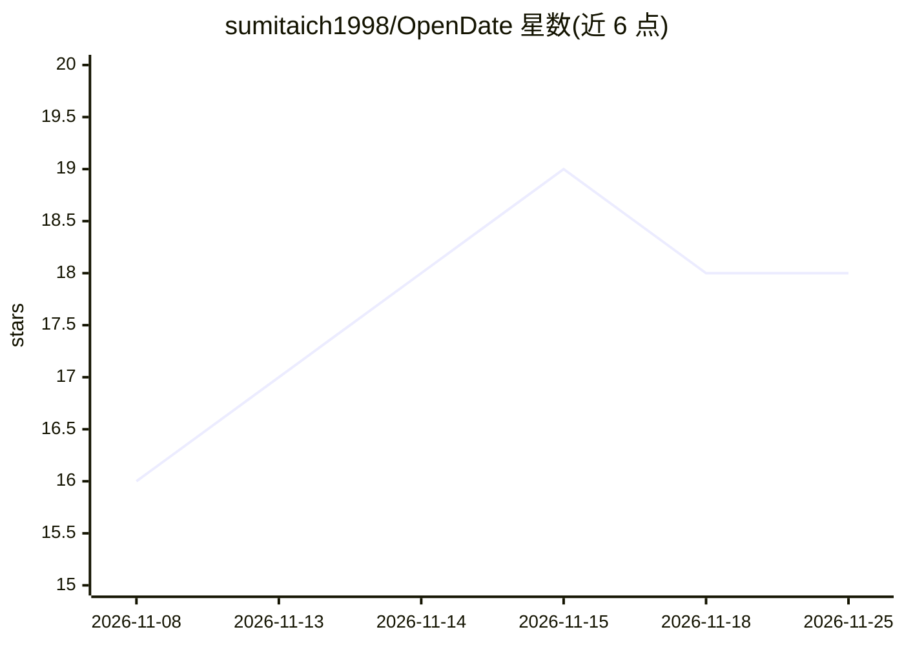

# sumitaich1998/OpenDate

⭐ 18 · Python · MIT · 推送 2026-07-22 · [GitHub](https://github.com/sumitaich1998/OpenDate) · 个人维护

**个人用 AI 约会 agent：用自有 Tinder token 与 LLM 代为筛选和聊天**

基于 Python 3.11+ 的开源约会 agent：用非官方 Tinder 接口同步匹配，按用户偏好筛选候选人，经 14 个 SKILL.md 技能（开场、调侃、约见面等）生成回复，再由从用户帖子与聊天记录学到的 persona 改写语气。每次发送前运行同意/安全守卫与节奏限制，auto_send 默认关闭。LLM 通过 litellm 路由接入 19 个 provider（西方与中国厂商），并提供 --mock 离线演示模式。README 警示 Tinder 无官方 API，自动化可能违反其服务条款，仅供个人/教育用途。

## 筛选速览

| 维度 | 判定 | 备注 |
|---|---|---|
| AI 角色 | `ai-native` | 本体是模型或模型工具 |
| 许可风险 | `permissive` | MIT |
| 部署形态 | `None` |  |
| 模型依赖 | locked-api |  |
| 硬件要求 | — | 无带数字的原话,不猜 |
| 安装摩擦 | `low` | 无编译、无系统依赖或容器化 |
| 成熟度 | — | 结构信号不足 |

## 能力要点

- 14 个 dating 技能按对话阶段选择，遵循 agentskills.io 标准
- 19 条 LLM provider 路由，覆盖西方与中国厂商，经 litellm 统一接入
- 从用户帖子与聊天记录学习 persona 并做风格迁移改写
- --mock 模式零凭据离线运行，每次发送前有人工审批守卫

## 适用场景

- 把候选匹配按个人偏好自动筛出 like/pass 预览
- 以自己的语气起草并审阅约会消息草稿
- 离线 mock 模式下演示或测试完整 agent 流程

## 场景标签

`聊天机器人` · 领域:对话与助手

## 证据(README 行号)

> L5: Your open-source AI wingman: bring your own Tinder token and any LLM key.
> L145: |**Generate**|Draft a reply with the chosen skill playbook + the LLM.|
> L187: A single `LLMRouter` (built on `litellm`) speaks to all of these. Choose one by

## 星数曲线

2026-11-08 16 → 2026-11-25 18（+2）

---
*卡片 v1 · prompt 1.4 · 生成 2026-11-18 · 置信度 high · 依据 README sha `e75ccc5635ac` · [字段定义](../../DATASET.md)*
