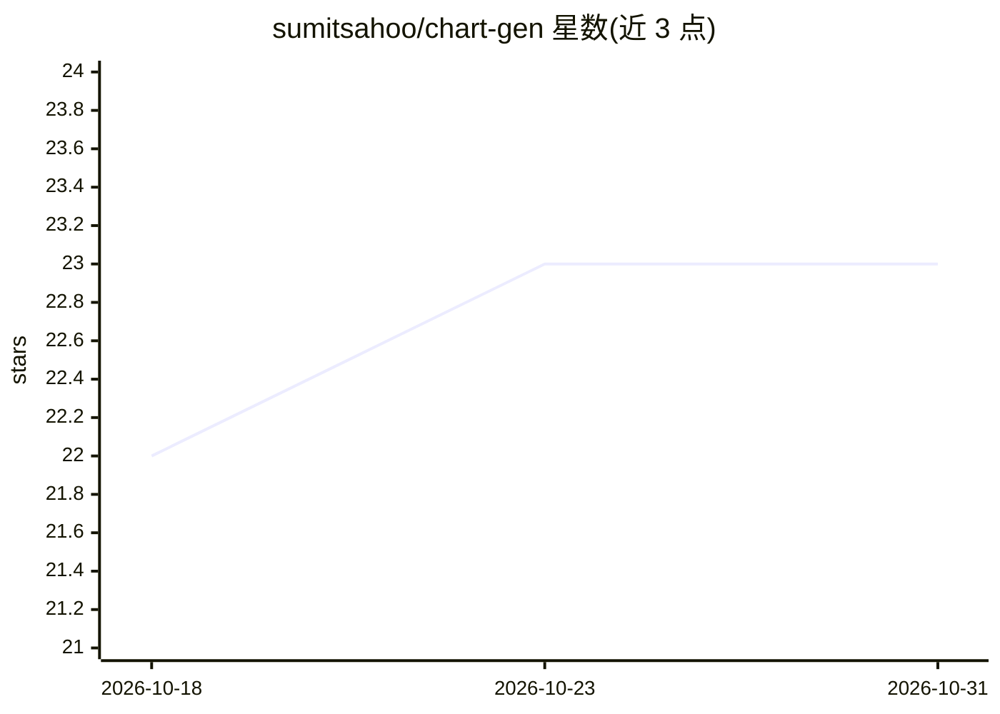

# sumitsahoo/chart-gen

⭐ 23 · Python · MIT · 推送 2026-01-30 · [GitHub](https://github.com/sumitsahoo/chart-gen) · 个人维护

**用 OpenAI Code Interpreter 生成图表的 Python 应用**

基于 OpenAI Assistants API（gpt-3.5-turbo-0125 或 gpt-4-0125-preview）与 Code Interpreter 生成图表的 Python 应用，UI 使用 Gradio 构建。用户输入需求后由模型经 Code Interpreter 执行生成图表。要求 Python 3.12.7 或 3.13.0，通过 poetry 管理依赖并运行 main.py 启动。附带作者 Medium 文章说明，采用 MIT 许可证。

## 筛选速览

| 维度 | 判定 | 备注 |
|---|---|---|
| AI 角色 | `ai-native` | 本体是模型或模型工具 |
| 许可风险 | `permissive` | MIT |
| 部署形态 | `None` |  |
| 模型依赖 | — | README 未给出锁定关系 |
| 硬件要求 | — | 无带数字的原话,不猜 |
| 安装摩擦 | `low` | 无编译、无系统依赖或容器化 |
| 成熟度 | — | 结构信号不足 |

## 能力要点

- 调用 OpenAI Assistants API 与 Code Interpreter 生成图表
- 支持 gpt-3.5-turbo-0125 与 gpt-4-0125-preview 模型
- 基于 Gradio 构建 UI
- 使用 poetry 管理依赖与虚拟环境

## 适用场景

- 通过对话描述快速生成数据图表
- 在本地运行使用自己的 OpenAI API 生成图表

## 场景标签

`数据分析` · 领域:效率与自动化

## 证据(README 行号)

> L2: Generate charts using OpenAI (gpt-3.5-turbo-0125 or gpt-4-0125-preview) and Code Interpreter with Assistants API.
> L54: UI is built using Gradio

## 星数曲线

2026-10-18 22 → 2026-10-31 23（+1）

---
*卡片 v1 · prompt 1.4 · 生成 2026-10-27 · 置信度 high · 依据 README sha `ef1b620d1603` · [字段定义](../../DATASET.md)*
