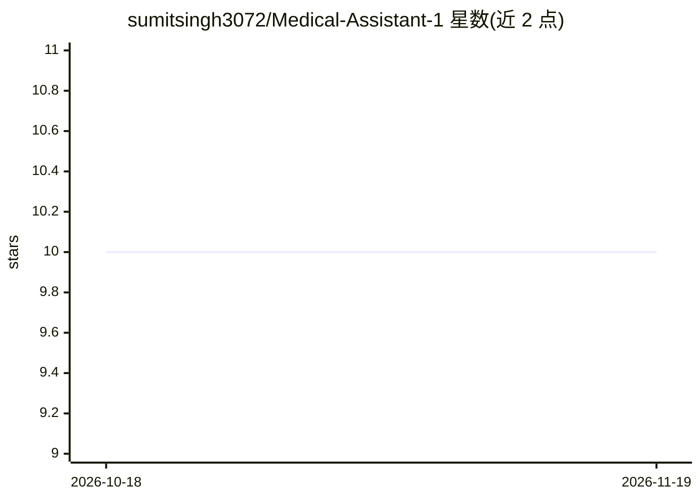

# sumitsingh3072/Medical-Assistant-1

⭐ 10 · JavaScript · MIT · 推送 2026-04-24 · [GitHub](https://github.com/sumitsingh3072/Medical-Assistant-1) · [官网](https://aimedivision.vercel.app/) · 组织维护

**医学影像分析助手：上传 X 光/CT/MRI 生成 AI 报告**

前后端分离的医疗影像辅助应用：React + Vite 前端上传影像，FastAPI + PyTorch 后端通过 timm 预训练模型对 X 光、CT（2D/3D NIfTI）、MRI、超声进行疾病预测，再由 Gemini Pro 生成 PDF 诊断报告并支持对话式问询报告内容。另提供基于地理位置的医生搜索与预约集成。使用 Clerk 做认证。安装方式为 pip 安装后端依赖、npm 安装前端依赖后分别启动。

## 筛选速览

| 维度 | 判定 | 备注 |
|---|---|---|
| AI 角色 | `ai-native` | 本体是模型或模型工具 |
| 许可风险 | `permissive` | MIT |
| 部署形态 | `library` | 以包/库形式分发 |
| 模型依赖 | — | README 未给出锁定关系 |
| 硬件要求 | — | 无带数字的原话,不猜 |
| 安装摩擦 | `low` | 无编译、无系统依赖或容器化 |
| 成熟度 | — | 结构信号不足 |

## 能力要点

- 多模态影像预测接口：X 光、CT 2D/3D、MRI 3D、超声
- Gemini Pro 生成诊断报告并支持对话式解读
- PDF 报告导出（含品牌与水印）
- 基于地理位置的医生搜索与预约集成

## 适用场景

- 上传医学影像获取疾病预测与 AI 报告
- 通过对话提问理解生成的诊断报告
- 按位置查找医生并集成预约

## 场景标签

`目标检测` · 领域:感知与多模态

## 证据(README 行号)

> L5: An intelligent diagnostic assistant for analyzing medical images (X-rays, CT scans, MRIs, and ultrasounds), generati
> L28: * 📊 **Detailed AI Report Generation**: Uses LLM to generate PDF-style medical reports.
> L49: Supports `xray`, `ct`, `ultrasound`, `mri`. Returns AI-generated diagnosis report.

## 星数曲线

2026-10-18 10 → 2026-11-19 10（+0）

---
*卡片 v1 · prompt 1.4 · 生成 2026-11-19 · 置信度 high · 依据 README sha `9c9632866706` · [字段定义](../../DATASET.md)*
