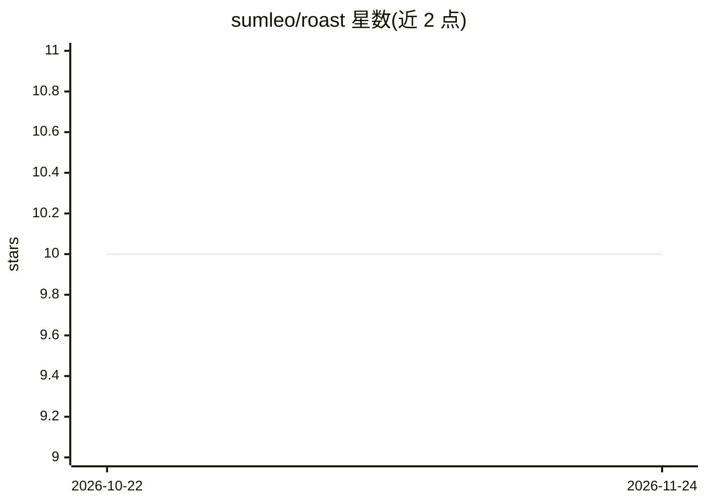

# sumleo/roast

⭐ 10 · MIT · 推送 2026-03-14 · [GitHub](https://github.com/sumleo/roast) · 个人维护 · 中文 README

**让 AI 以苏格拉底式追问拷问你的想法的 agent 技能**

Roast 是一个可安装到 Claude Code、Codex CLI、Cursor、Kiro、OpenClaw 的 agent 技能：AI 不回答用户问题，而是按 5 个深度层级逐层追问，提供苏格拉底、第一性原理、魔鬼代言人、VC 模式等 7 种提问风格，并内置针对常见回避话术的反回避回应表与 10 种认知偏差的对话中检测；会话结束输出结构化深度报告。支持中/英/日三语，各语言有独立适配的技能文件，通过各宿主的插件市场、curl 或 git clone 安装。

## 筛选速览

| 维度 | 判定 | 备注 |
|---|---|---|
| AI 角色 | `ai-native` | 本体是模型或模型工具 |
| 许可风险 | `permissive` | MIT |
| 部署形态 | `None` |  |
| 模型依赖 | — | README 未给出锁定关系 |
| 硬件要求 | — | 无带数字的原话,不猜 |
| 安装摩擦 | `low` | 无编译、无系统依赖或容器化 |
| 成熟度 | — | 结构信号不足 |

## 能力要点

- 5 个深度层级渐进追问，不可跳级
- 7 种提问风格（苏格拉底/第一性原理/VC 模式等）
- 反回避系统与 10 种认知偏差的对话中检测
- 中/英/日三语独立技能文件

## 适用场景

- 融资前对自己的 pitch 做压力测试
- 论文提交前检验论证是否站得住脚
- 架构决策前追问自己方案的漏洞
- 做不可逆决定前把思路想透

## 场景标签

`AI 助手` · 领域:对话与助手

## 证据(README 行号)

> L34: Roast is an AI agent skill that flips the script. Instead of answering your questions, your AI **asks** them — prog
> L111: # Plugin marketplace (recommended)
> L116: git clone https://github.com/sumleo/roast.git ~/.claude/plugins/roast

## 星数曲线

2026-10-22 10 → 2026-11-24 10（+0）

---
*卡片 v1 · prompt 1.4 · 生成 2026-11-19 · 置信度 high · 依据 README sha `b9dfff9cd88d` · [字段定义](../../DATASET.md)*
