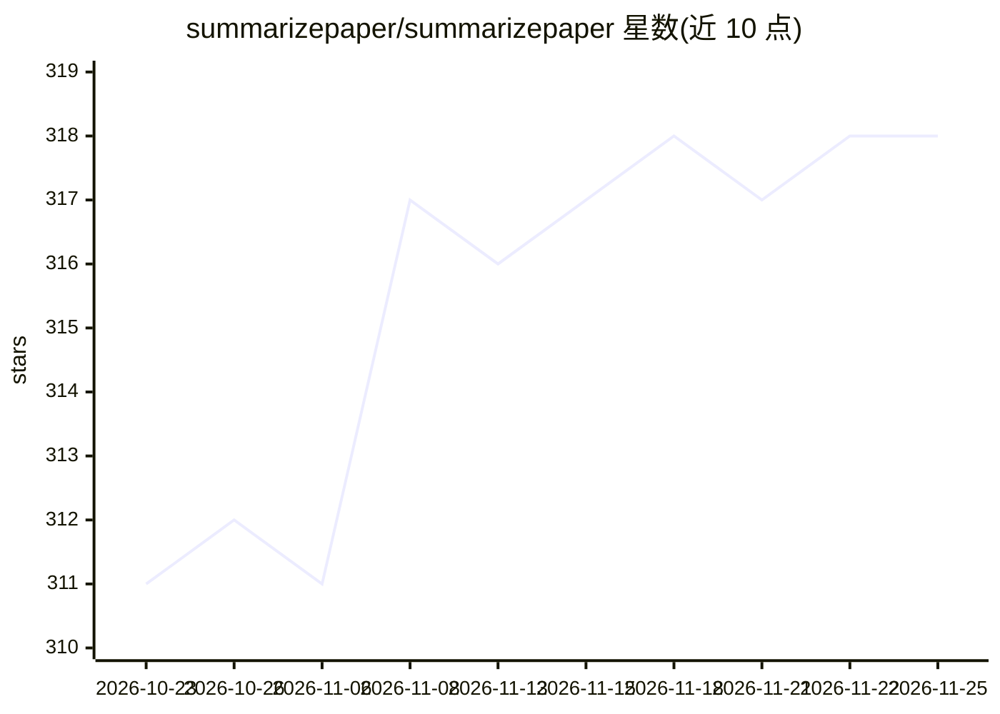

# summarizepaper/summarizepaper

⭐ 318 · Python · MIT · 推送 2026-11-21 · [GitHub](https://github.com/summarizepaper/summarizepaper) · [官网](https://www.summarizepaper.com) · 个人维护

**面向研究人员的论文摘要、全文问答与文献追踪工具**

面向研究人员的论文辅助 Web 应用：对 arXiv、bioRxiv、medRxiv 等来源的论文生成摘要、关键点与多语言改写；支持基于全文的论文问答与多篇论文的带出处对比表；提供每日摘要、保存的检索、上升话题、引用提醒、文献综述、新闻资料包与报告幻灯片等功能，部分功能属付费层级。技术栈为 Django 5.2、Channels/Redis、PostgreSQL，部署于 Heroku；文本、嵌入与语音使用 OpenAI 模型，元数据来自 arXiv、OpenAlex、Crossref 等多个学术 API。本地运行需 Python 3.12 与 Redis。

## 筛选速览

| 维度 | 判定 | 备注 |
|---|---|---|
| AI 角色 | `ai-native` | 本体是模型或模型工具 |
| 许可风险 | `permissive` | MIT |
| 部署形态 | `library` | 以包/库形式分发 |
| 模型依赖 | — | README 未给出锁定关系 |
| 硬件要求 | — | 无带数字的原话,不猜 |
| 安装摩擦 | `low` | 无编译、无系统依赖或容器化 |
| 成熟度 | — | 结构信号不足 |

## 能力要点

- 基于全文的论文问答，每条回答附对应原文段落链接
- 多篇论文逐格带出处的对比表
- 每日摘要、上升话题、引用提醒等文献追踪功能
- 支持 16 种语言改写摘要与法语本地化

## 适用场景

- 快速读取一篇论文的要点并向全文提问
- 追踪所在领域的新论文与上升话题
- 为一项研究问题整理文献综述
- 准备期刊俱乐部报告幻灯片

## 场景标签

`科研工具` `文档问答` · 领域:知识与检索

## 证据(README 行号)

> L3: **AI tools for researchers, from reading a paper to presenting it.** Summaries and a chat that answer
> L26: |Chat with papers|Questions to one paper or several at once, answered from the full text with the passage behind ea
> L64: Django 5.2 served by Daphne (ASGI), Channels websockets over Redis, PostgreSQL, on Heroku. Python 3.12.

## 星数曲线

2026-10-23 311 → 2026-11-25 318（+7）

---
*卡片 v1 · prompt 1.4 · 生成 2026-11-25 · 置信度 high · 依据 README sha `e7aca1b638e0` · [字段定义](../../DATASET.md)*
