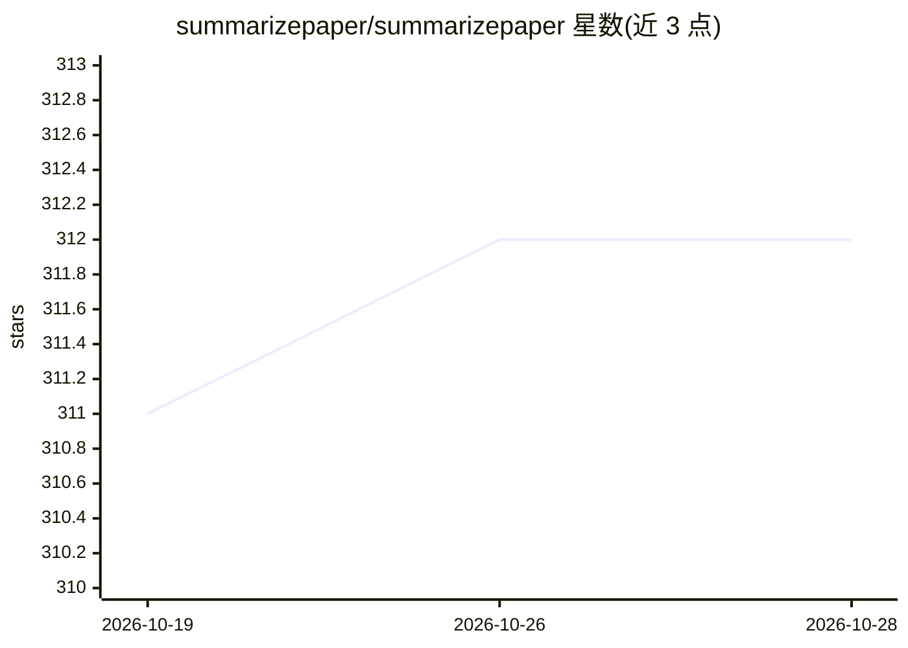

# summarizepaper/summarizepaper

⭐ 312 · Python · 推送 2026-10-27 · [GitHub](https://github.com/summarizepaper/summarizepaper) · 个人维护

**arXiv 论文 AI 摘要网站，附全文问答助手**

基于 Django 5.2 的 Web 应用：从 arXiv 抓取论文（优先 HTML、PDF 回退）生成详细摘要、要点、通俗摘要与博客式文章，支持英文/法语；提供基于论文全文的流式问答助手，可同时与多篇论文对话，并有每日邮件摘要、BibTeX/PDF 导出、Stripe 付费订阅（更强模型与更高额度）。部署面向 Heroku（PostgreSQL、Redis、Channels websocket），本地运行需 Python 3.11 venv、Redis 与 OPENAI_KEY 环境变量。

## 筛选速览

| 维度 | 判定 | 备注 |
|---|---|---|
| AI 角色 | `ai-native` | 本体是模型或模型工具 |
| 许可风险 | `none` | — |
| 部署形态 | `library` | 以包/库形式分发 |
| 模型依赖 | — | README 未给出锁定关系 |
| 硬件要求 | — | 无带数字的原话,不猜 |
| 安装摩擦 | `low` | 无编译、无系统依赖或容器化 |
| 成熟度 | — | 结构信号不足 |

## 能力要点

- 论文全文问答助手（流式回答，可多论文对话）
- 四种摘要形式（详细/要点/通俗/博客式），支持英法双语
- 订阅类别新论文的每日邮件摘要
- Stripe 付费订阅与配额控制（服务端核验）

## 适用场景

- 快速了解 arXiv 新论文的核心内容
- 针对某篇论文全文提问获得解答
- 订阅关注领域的每日论文邮件推送

## 场景标签

`科研工具` `文档问答` · 领域:知识与检索

## 证据(README 行号)

> L3: A web application that uses AI to summarize academic papers from arXiv and provides a virtual assistant :robot: to a
> L8: - An AI assistant that answers questions from the full text of the paper, with streamed answers

## 星数曲线

2026-10-19 311 → 2026-10-28 312（+1）

---
*卡片 v1 · prompt 1.4 · 生成 2026-10-21 · 置信度 mid · 依据 README sha `f7bdbf922ff7` · [字段定义](../../DATASET.md)*
