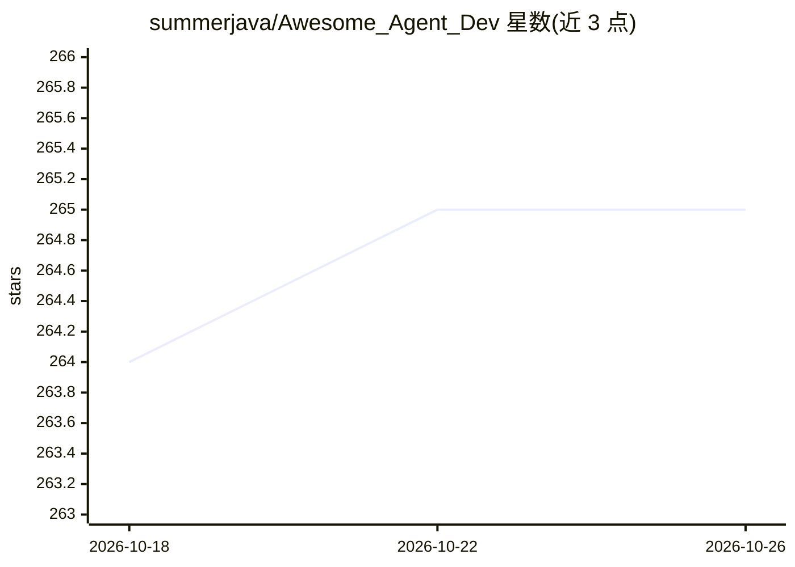

# summerjava/Awesome_Agent_Dev

⭐ 265 · Python · 推送 2026-05-05 · [GitHub](https://github.com/summerjava/Awesome_Agent_Dev) · 个人维护 · 中文 README

**AI Agent 开发学习路线与面试准备的中文资源清单**

汇总大模型应用（Agent）开发的学习资料：学习路线、体系化课程、经典书籍与博客、Prompt 工程、LangChain/LangGraph/AutoGen 等框架、RAG 与向量数据库、Skills 教程、Agent 评估与可观测性、Vibe Coding、入门案例、企业级项目建议、面试准备与工业界落地案例。条目以链接形式组织，面向准备学习或求职的 Agent 开发者；README 同时包含作者一对一辅导服务推广与二维码。

## 筛选速览

| 维度 | 判定 | 备注 |
|---|---|---|
| AI 角色 | `ai-knowledge` | 知识聚合/清单类 |
| 许可风险 | `none` | — |
| 部署形态 | `None` |  |
| 模型依赖 | — | README 未给出锁定关系 |
| 硬件要求 | — | 无带数字的原话,不猜 |
| 安装摩擦 | `low` | 无编译、无系统依赖或容器化 |
| 成熟度 | — | 结构信号不足 |

## 能力要点

- 覆盖学习路线、教程、书籍、框架、RAG、Skills、评估、可观测性的分栏清单
- 包含职业发展、企业级项目与面试准备内容
- 收录工业界落地案例与热门 AI 工具（DeepWiki、Claude Code 等）

## 适用场景

- 系统学习 Agent 开发从入门到落地
- 准备 AI Agent 工程师岗位的面试与简历项目
- 查找 Agent 框架、RAG、Skills 相关的开源项目与教程

## 场景标签

`精选清单` · 领域:学习与行业

## 证据(README 行号)

> L3: > 🎯 From zero to building your own AI-powered applications — a complete learning roadmap for **Agent Application Dev
> L4: > 📚 汇总大模型应用（Agent）开发的学习路线、资料、工具、开源项目与面试准备指南，帮助你系统掌握从入门到落地的全流程。
> L10: 保姆级学习路线（持续更新，跟着学就够了）：

## 星数曲线

2026-10-18 264 → 2026-10-26 265（+1）

---
*卡片 v1 · prompt 1.4 · 生成 2026-10-22 · 置信度 high · 依据 README sha `b0b7ecc57b63` · [字段定义](../../DATASET.md)*
