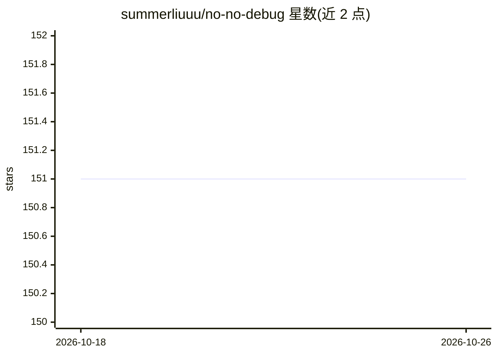

# summerliuuu/no-no-debug

⭐ 151 · Python · MIT · 推送 2026-05-07 · [GitHub](https://github.com/summerliuuu/no-no-debug) · 个人维护 · 中文 README

**AI 编程助手的跨会话错误记忆与自我进化技能**

面向 AI 编程助手（以 Claude Code 为主）的自进化系统：以 SKILL.md 形式安装，自动记录纠正与错误到本地 error_log.md，通过三道关卡（变更前影响确认、变更后验证、部署前非管理员测试）、定期回顾（默认 3 天，可配 1/3/7 天）、规则累积（新错误类型生成预防规则，连续 4 个干净周期标记治愈）形成反馈循环；另有确认门与自动配置 hooks。跟踪 18 个维度。完整自动 hooks 仅限 Claude Code，其他助手需粘贴 SKILL.md 且依赖模型自觉遵循。

## 筛选速览

| 维度 | 判定 | 备注 |
|---|---|---|
| AI 角色 | `ai-ecosystem` | LLM/agent 周边工具 |
| 许可风险 | `permissive` | MIT |
| 部署形态 | `None` |  |
| 模型依赖 | — | README 未给出锁定关系 |
| 硬件要求 | — | 无带数字的原话,不猜 |
| 安装摩擦 | `low` | 无编译、无系统依赖或容器化 |
| 成熟度 | — | 结构信号不足 |

## 能力要点

- 错误自动记录到本地 error_log.md 并按维度归类定期回顾
- 规则跨会话持久化，新错误类型自动生成预防规则
- 三道关卡：变更前影响、变更后验证、部署前非管理员测试
- 18 个跟踪维度，覆盖验证、回归、风格一致性等

## 适用场景

- 让 Claude Code 记住历史错误避免重复调试
- 为 ChatGPT/Cursor/Copilot 等助手添加跨会话错误记忆
- 在部署前强制执行非管理员账号测试等检查点

## 场景标签

`Agent 记忆` · 领域:Agent 开发

## 证据(README 行号)

> L3: A self-evolution system for AI coding assistants
> L17: This skill fills the gap in AI's cross-session error memory, delivering three things:
> L56: Automatically configures Claude Code hooks on install:

## 星数曲线

2026-10-18 151 → 2026-10-26 151（+0）

---
*卡片 v1 · prompt 1.4 · 生成 2026-10-22 · 置信度 high · 依据 README sha `eeac76e2c085` · [字段定义](../../DATASET.md)*
