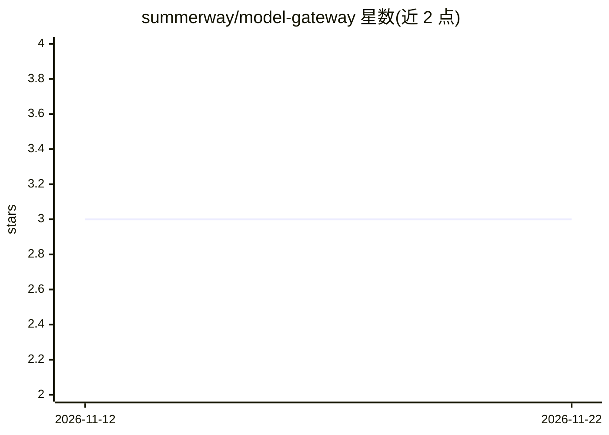

# summerway/model-gateway

⭐ 3 · JavaScript · MIT · 推送 2026-11-15 · [GitHub](https://github.com/summerway/model-gateway) · [官网](https://model-gateway.maplesnow.cn) · 个人维护 · 中文 README

**自托管 LLM 网关：多渠道统一接入、fallback 接力与用量看板**

一个自托管网关服务，把多家 AI 订阅与 API 汇成单一 OpenAI 兼容入口，支持 Anthropic 原生透传、SSE 流式转发与按配置顺序的跨渠道 fallback（含冷却与模型名改写）。提供订阅额度探测、served/observed 双轨用量统计与成本折算、模型升级建议 Inbox。无管理 UI，配置管理通过 Admin API（JSON Patch 预览后应用、热加载）交给 AI agent 完成。Node.js ≥22.13，npm 全局安装或 Docker 运行。

## 筛选速览

| 维度 | 判定 | 备注 |
|---|---|---|
| AI 角色 | `ai-ecosystem` | LLM/agent 周边工具 |
| 许可风险 | `permissive` | MIT |
| 部署形态 | `self-host` | docker 或自建部署 |
| 模型依赖 | locked-api |  |
| 硬件要求 | — | 无带数字的原话,不猜 |
| 安装摩擦 | `low` | 无编译、无系统依赖或容器化 |
| 成熟度 | — | 结构信号不足 |

## 能力要点

- OpenAI Chat Completions/Responses、Anthropic Messages 原生透传、图像生成与文本向量端点
- 按配置顺序的 fallback 链：网络错误/429/5xx/额度用尽自动切换，失败渠道进入冷却
- 订阅 5 小时与每周额度跟踪、自动续窗，served 与 observed 用量分开统计不重复计费
- Admin API + agent skills 让 AI 通过 JSON Patch 预览/回滚流程管理网关配置

## 适用场景

- 同时持有多个 AI 订阅和 API，客户端只想配一个地址一把 key
- 某家渠道限流或出错时自动接力到下一家不停服
- 统一看板查看各渠道、模型、设备的用量与成本
- 把网关运维（加渠道、调链序）交给 AI agent 执行

## 场景标签

`模型网关` · 领域:Agent 开发

## 证据(README 行号)

> L1: model-gateway：自托管 LLM 网关。Claude Code、Codex 和你的应用经一个网关接入 GLM、Codex、DeepSeek 等渠道，某个渠道失败时沿 fallback 链接力到下一个。
> L9: 给同时用好几家 AI 订阅和 API 的人：客户端只配一个地址、一把 key，网关按模型路由到各家渠道，某家限流或出错就沿你配置的顺序自动换下一家；用量、额度和模型升级都在一个看板里看。管理不做 UI，交给 AI 通过 Admin 
> L110: - `src/gateway/`：数据面，路由、fallback 与熔断、视觉路由、原生透传，产生 served 用量。

## 星数曲线

2026-11-12 3 → 2026-11-22 3（+0）

---
*卡片 v1 · prompt 1.4 · 生成 2026-11-21 · 置信度 high · 依据 README sha `ff3732df29a9` · [字段定义](../../DATASET.md)*
