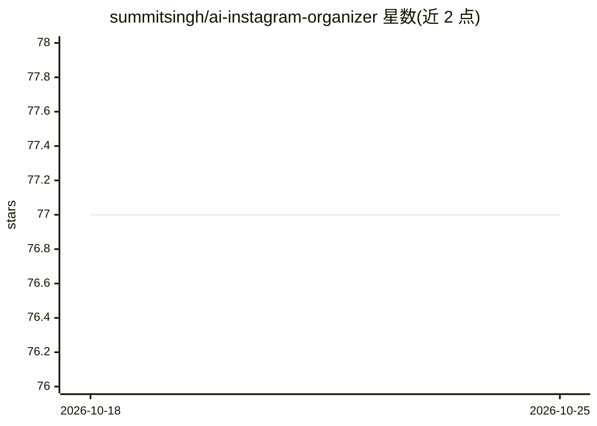

# summitsingh/ai-instagram-organizer

⭐ 77 · Python · MIT · 推送 2026-10-15 · [GitHub](https://github.com/summitsingh/ai-instagram-organizer) · 个人维护

**把照片库自动整理成 Instagram 帖子并生成文案与话题标签的 CLI 工具**

面向个人用户的照片整理命令行工具：按拍摄日期将照片组织为 Instagram 轮播帖，分析照片质量与适合度，生成配文与话题标签，支持重复检测、HEIC 转换、多平台内容生成（TikTok/Twitter/LinkedIn）与可选的 ffmpeg 动态 Reel 拼装。AI 部分支持三种提供方：Llama API（云端默认）、Gemini（云端）、Ollama（本地）。另含 trip-dump 流水线：按日期与 GPS 聚类旅行照片、dHash 去重、SQLite 记录已发布帖，并附可安装到 Claude Code/Codex 等助手的 SKILL.md。以 pip 从 GitHub 安装，尚未发布到 PyPI。

## 筛选速览

| 维度 | 判定 | 备注 |
|---|---|---|
| AI 角色 | `ai-native` | 本体是模型或模型工具 |
| 许可风险 | `permissive` | MIT |
| 部署形态 | `library` | 以包/库形式分发 |
| 模型依赖 | local-ok | 支持本地模型 |
| 硬件要求 | — | 无带数字的原话,不猜 |
| 安装摩擦 | `medium` | 含编译或系统依赖之一 |
| 成熟度 | — | 结构信号不足 |

## 能力要点

- 三种 AI 提供方可选：Llama（默认）/Gemini/Ollama（本地）
- trip-dump 流水线：日期+GPS 聚类、dHash 去重、人脸检查、SQLite 已发布记录
- 生成 Instagram 帖子结构化输出目录（时间线帖/精选帖）
- 提供可安装到 Claude Code/Codex/OpenClaw 的 agent 技能文件

## 适用场景

- 把旅行照片库批量整理成可发布的轮播帖草稿
- 为照片自动生成配文和优化话题标签
- 在本地用 Ollama 私密处理照片，不调用云端 API

## 场景标签

`AI 写作` `图像视频处理` · 领域:内容生成

## 证据(README 行号)

> L9: - Supports **Llama** (cloud, default), **Ollama** (local), and **Gemini** (cloud) AI providers
> L10: - Analyzes photos for Instagram worthiness and quality scoring
> L11: - Generates engaging captions with photo-specific references

## 星数曲线

2026-10-18 77 → 2026-10-25 77（+0）

---
*卡片 v1 · prompt 1.4 · 生成 2026-10-24 · 置信度 high · 依据 README sha `80e961d68e55` · [字段定义](../../DATASET.md)*
