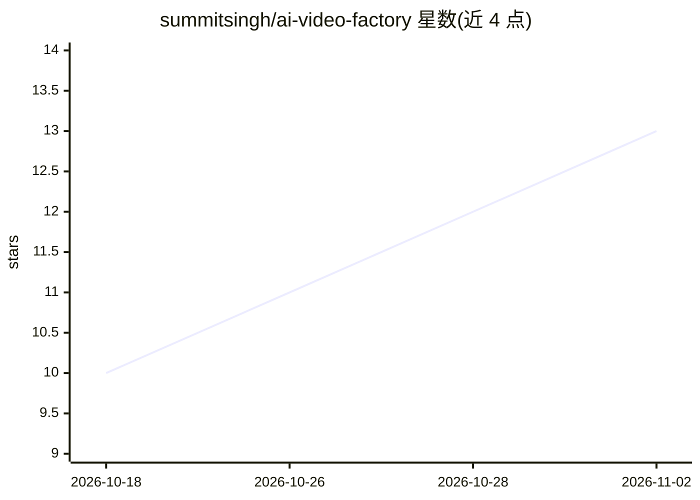

# summitsingh/ai-video-factory

⭐ 13 · Python · MIT · 推送 2026-10-19 · [GitHub](https://github.com/summitsingh/ai-video-factory) · 个人维护

**输入主题自动生成长篇纪录片式视频的工具**

面向在本地运行自动化视频生产的用户：给定一个主题，流水线完成资料搜集与引用核验、纪录片脚本生成（含时长强制）、素材与本地 AI 画面生成、本地 TTS 配音、配乐、卡拉OK字幕、FFmpeg 合成、QC 检查与 YouTube 元数据打包，面向 20-30 分钟长视频，也支持 90 秒短格式。脚本写作需自备 OpenAI 兼容端点（LM Studio、llama-server 或托管 API）；LTX-2 本地视频片段为可选后端，需 ROCm/CUDA torch 与约 100GB 权重。

## 筛选速览

| 维度 | 判定 | 备注 |
|---|---|---|
| AI 角色 | `ai-native` | 本体是模型或模型工具 |
| 许可风险 | `permissive` | MIT |
| 部署形态 | `None` |  |
| 模型依赖 | — | README 未给出锁定关系 |
| 硬件要求 | — | 无带数字的原话,不猜 |
| 安装摩擦 | `medium` | 含编译或系统依赖之一 |
| 成熟度 | — | 结构信号不足 |

## 能力要点

- 引用 URL 逐条核验（HTTP 200），失效即报错
- 脚本时长强制（约 150 wpm，25 分钟目标即 25 分钟）
- 逐场景素材路由：优先实拍素材，本地 LTX-2 片段与 SDXL-Turbo 静帧可选
- QC 门禁：黑帧、静音、低音量、分辨率与时长偏差自动判失败

## 适用场景

- 自动产出 YouTube 长视频成片（脚本/画面/配音/字幕/缩略图）
- 批量无人值守生成热点主题视频（nightly-batch）
- 在本地用自己的 LLM 端点完成脚本写作

## 场景标签

`视频生成` · 领域:内容生成

## 证据(README 行号)

> L3: Turn a topic into a long-form, documentary-style video: researched and
> L14: 2. **Script** - generates a multi-beat documentary script with a cold-open
> L18:  local LTX-2 AI hero clips for impossible shots, cinematic AI stills,
> L20: 4. **Voiceover** - full narration via local TTS.

## 星数曲线

2026-10-18 10 → 2026-11-02 13（+3）

---
*卡片 v1 · prompt 1.4 · 生成 2026-10-31 · 置信度 high · 依据 README sha `1f84726fe2d3` · [字段定义](../../DATASET.md)*
